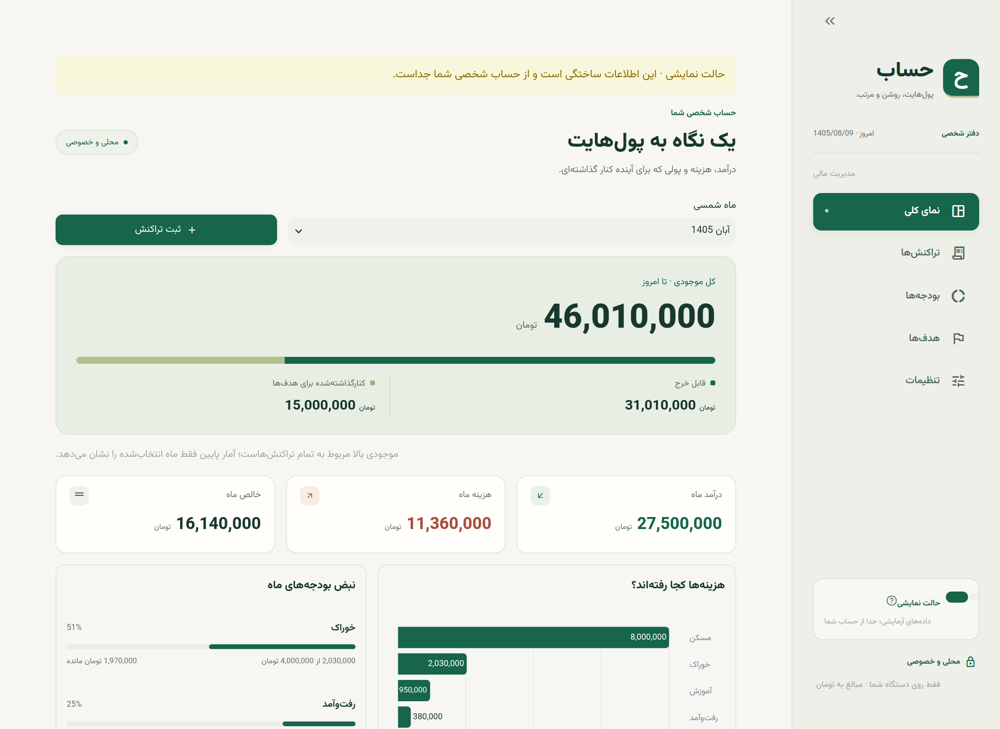
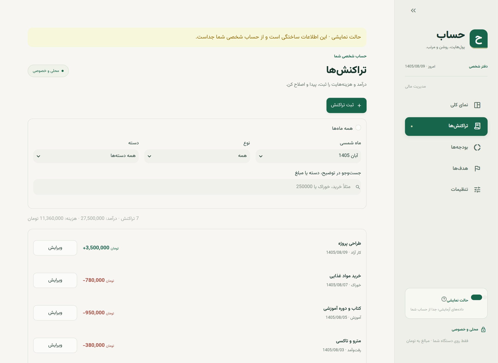
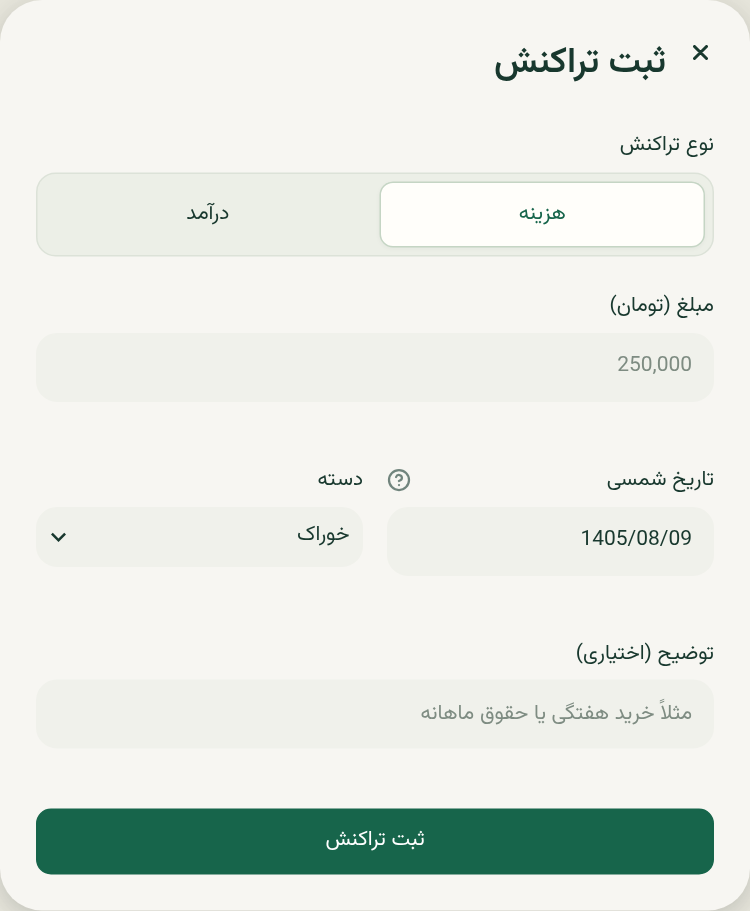
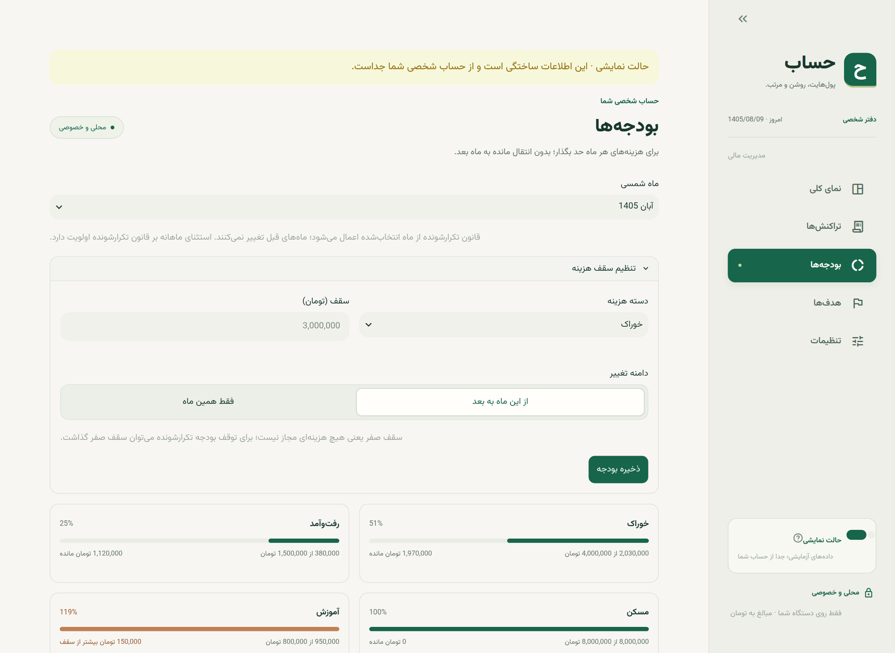
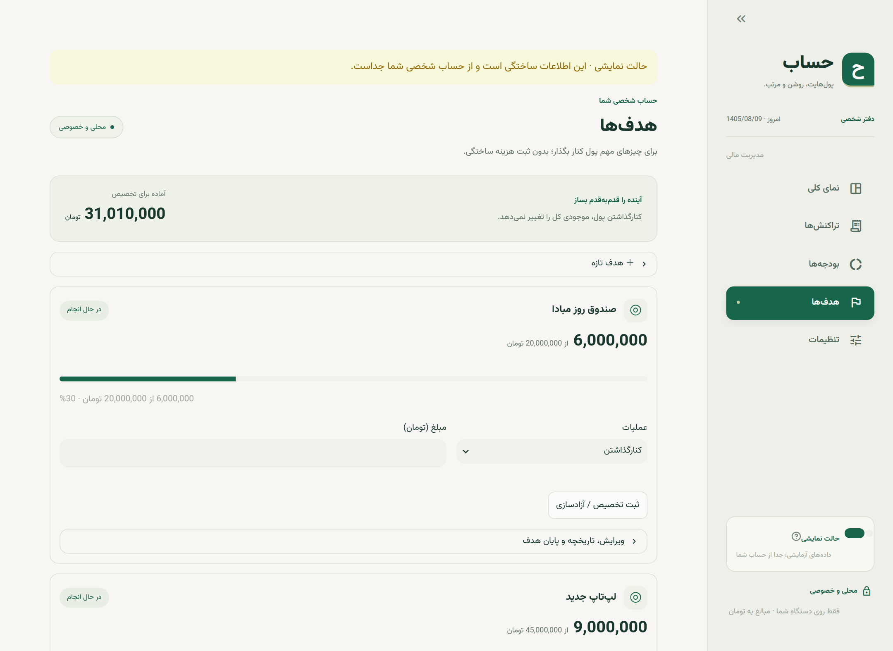
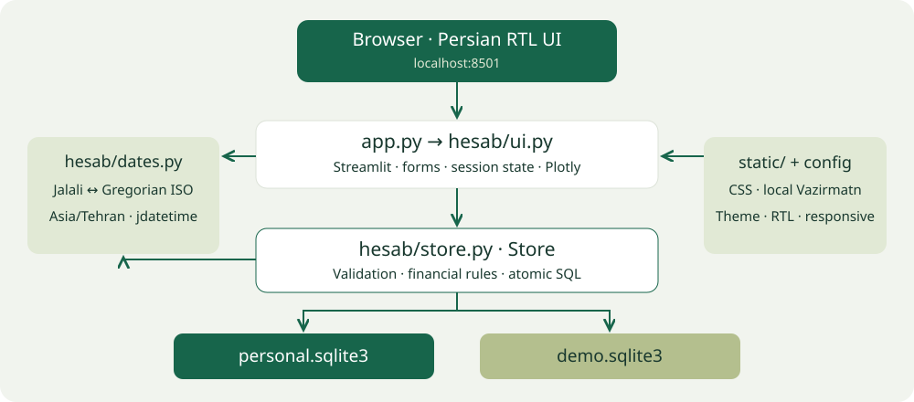
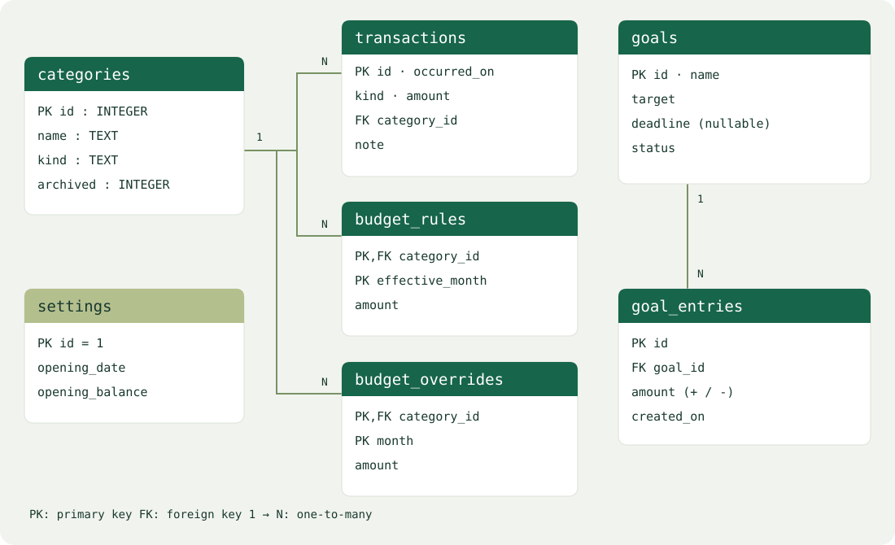
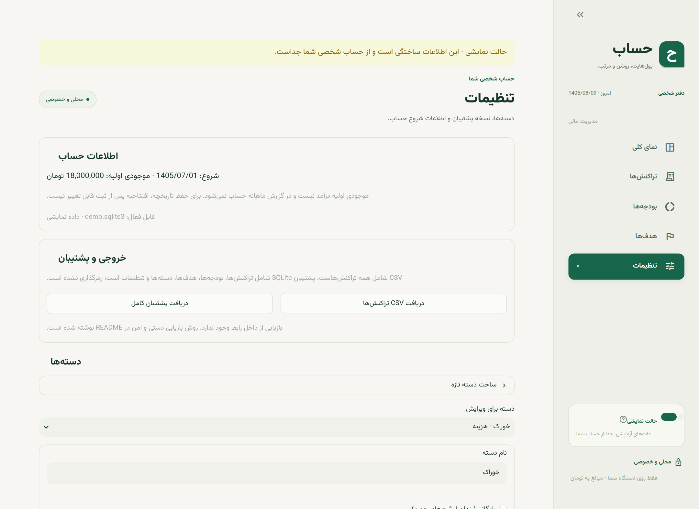

<!-- slide: cover -->

[نام دانشگاه / دانشکده] · ارائه پروژه [عنوان درس]

<h1>حساب</h1><h2>پول‌هایت، روشن و مرتب.</h2>
طراحی و پیاده‌سازی سامانه مدیریت مالی شخصی

فارسی و شمسیمحلی و تک‌کاربره

یک اصل در طراحی
<h2>همه موجودی، قابل خرج نیست.</h2>
<i></i><i></i>

قابل خرج ← موجودی → ذخیره هدف‌ها

نمایش مفهومی؛ نسبت نوار، داده مالی واقعی نیست.

دانشجو[نام و نام خانوادگی]

استاد[نام استاد]

شماره دانشجویی[شماره دانشجویی]

عنوان درس[عنوان درس]

شماره ترم / نیمسال[شماره ترم / نیمسال تحصیلی]

تاریخ ارائه[تاریخ ارائه شمسی]

<!-- notes: خودتان و موضوع را معرفی کنید. پروژه یک ابزار شخصی برای ثبت دستی مالی است، نه اتصال به حساب بانکی. از جمله روی کارت برای شروع استفاده کنید: داشتن پول در حساب لزوماً یعنی امکان خرج همه آن نیست. -->

---

<!-- slide -->

مسئله و مسیر ارائه

# چرا «حساب»؟

از ثبت پراکنده هزینه‌ها به یک تصویر قابل فهم از پول.

<h3>ثبت روزمره</h3>
درآمد و هزینه با تاریخ شمسی، دسته و توضیح در یک دفتر محلی.

<h3>کنترل ماه</h3>
مقایسه مصرف دسته‌ها با سقف بودجه و دیدن اضافه‌خرج.

<h3>دیدن آینده</h3>
تفکیک پول قابل خرج از مبلغی که برای هدف‌ها کنار گذاشته‌ایم.

یک کاربر، یک موجودی، تصمیم‌های مالی روشن‌تر.<small>مسیر ارائه: محصول ← قواعد مالی ← معماری و داده ← ارزیابی</small>

<!-- notes: مسئله را با یک مثال ساده توضیح دهید: بخشی از موجودی برای لپ‌تاپ کنار گذاشته شده، اما در موجودی بانکی همچنان دیده می‌شود. ابزار باید این تفاوت را روشن کند. مسیر ارائه را در یک جمله بگویید. حدود 35 ثانیه. -->

---

<!-- slide -->

دامنه و فناوری

# کوچک، اما با چرخه کامل

<h3>در این نسخه</h3><ul><li>ثبت، اصلاح و حذف تراکنش</li><li>بودجه تکرارشونده و استثنای ماهانه</li><li>هدف، تخصیص و تاریخچه</li><li>CSV و پشتیبان کامل</li></ul>

<h3>مرزهای آگاهانه</h3><ul><li>بدون بانک، ورود کاربر یا ابر</li><li>بدون چند حساب و چند ارز</li><li>بدون ورود CSV یا تراکنش آینده</li><li>بدون رمزگذاری فایل‌ها</li></ul>

Python 3.12+StreamlitSQLitePlotlyjdatetimeuv

<!-- notes: روی همه جزئیات مکث نکنید. تأکید کنید محدودکردن دامنه باعث تمرکز بر دقت قواعد و کیفیت تجربه شده است. Streamlit سرعت توسعه و SQLite استقرار بدون سرور را ممکن می‌کنند. -->

---

<!-- slide -->

محصول · نمای کلی

# اول موجودی؛ بعد جزئیات ماه

تصویر واقعی برنامه · فقط داده ساختگی

<h3>سه لایه اطلاعات</h3><ul><li>کل موجودی و نحوه تخصیص</li><li>درآمد، هزینه و خالص ماه</li><li>نمودار دسته‌ها و وضعیت بودجه</li></ul>

تغییر ماه، آمار ماه را عوض می‌کند؛ نه موجودی کل را.

<!-- notes: در تصویر ابتدا موجودی بزرگ و سپس نوار دو قسمتی را نشان دهید. توضیح دهید کارت بالا از همه تراکنش‌ها و آمار پایین از ماه انتخاب‌شده است. در ارائه زنده می‌توانید ماه را تغییر دهید. -->

---

<!-- slide -->

اصل مالی پروژه

# پس‌انداز، هزینه نیست.

تخصیص به هدف فقط پول موجود را رزرو می‌کند.

<table class="comparison"><thead><tr><th>رویداد نمونه</th><th>کل موجودی</th><th>ذخیره</th><th>قابل خرج</th></tr></thead><tbody><tr><td>موجودی اولیه</td><td>10,000,000</td><td>0</td><td>10,000,000</td></tr><tr><td>تخصیص 4,000,000 به هدف</td><td>10,000,000</td><td>4,000,000</td><td>6,000,000</td></tr><tr><td>ثبت هزینه 1,000,000</td><td>9,000,000</td><td>4,000,000</td><td>5,000,000</td></tr></tbody></table>

قابل خرج = موجودی کل − ذخیره هدف‌ها<small>افتتاحیه درآمد نیست؛ خرید واقعی باید جداگانه به‌عنوان هزینه ثبت شود.</small>

<!-- notes: اعداد این اسلاید یک مثال آموزشی هستند و با ارقام تصویر الزاماً برابر نیستند. روی ثابت ماندن کل موجودی هنگام تخصیص تأکید کنید. این مهم‌ترین قاعده دامنه پروژه است. -->

---

<!-- slide -->

محصول · تراکنش‌ها

# ثبت ساده، اصلاح قابل کنترل

فیلتر ماه، نوع و دسته؛ جست‌وجوی توضیح، دسته یا مبلغ

<h3>قواعد ثبت</h3><ul><li>مبلغ مثبت و صحیح، به تومان</li><li>تاریخ از شروع حساب تا امروز</li><li>دسته متناسب با نوع</li><li>حذف فقط با تأیید کاربر</li></ul>
کسری موجودی هشدار می‌دهد؛ ثبت واقعیت را ممنوع نمی‌کند.

<!-- notes: ثبت هزینه واقعی حتی با کسری مجاز است تا نرم‌افزار واقعیت را تحریف نکند. ویرایش و حذف، گزارش‌ها را مجدداً محاسبه می‌کنند. اشاره کنید دسته بایگانی‌شده از ثبت جدید پنهان می‌شود ولی سابقه را از بین نمی‌برد. -->

---

<!-- slide -->

پیاده‌سازی · مرز ورودی و منطق مالی

# از ورودی فارسی تا داده معتبر

<h3>مرز تبدیل و اعتبارسنجی</h3><ul><li><code>amount_value()</code>: تبدیل ارقام به integer تومان</li><li><code>parse_jalali()</code>: تاریخ شمسی به date</li><li><code>Store</code>: کنترل بازه تاریخ و نوع دسته</li><li>SQL پارامتری؛ بدون الحاق متن کاربر</li></ul>

رابط، ورودی را تبدیل می‌کند؛ Store قواعد مالی را اعمال می‌کند.

<!-- notes: مسیر فنی را روی فرم توضیح دهید: رقم فارسی و جداکننده مبلغ به integer تبدیل می‌شود؛ تاریخ شمسی به date تبدیل می‌شود؛ Store مثبت بودن مبلغ، تاریخ افتتاحیه تا امروز و یکسانی نوع دسته را بررسی می‌کند. مبلغ float ذخیره نمی‌شود و اعشار رد می‌شود. مقادیر SQL با پارامتر جدا ارسال می‌شوند، نه الحاق رشته. این تفکیک اجازه می‌دهد همان قواعد بدون مرورگر آزموده شوند. -->

---

<!-- slide -->

بودجه · انتخاب نسخه مؤثر

# سقف ماه چگونه انتخاب می‌شود؟

سقف نظارتی هزینه؛ نه برداشت یا تخصیص واقعی پول

<h3>الگوریتم انتخاب سقف</h3><ol><li>استثنای دقیق دسته و ماه</li><li>در نبود استثنا: آخرین قانون با <code>effective_month ≤ month</code></li><li>در نبود قانون: بدون سقف</li></ol>

کلید مرکب دسته و ماه؛ مقدار صفر معتبر است، نبود رکورد یعنی بدون بودجه.

<!-- notes: دو جدول جدا مسئولیت متفاوت دارند: budget_rules برای قانون از ماه اثرگذاری به بعد و budget_overrides برای استثنای یک ماه. ابتدا استثنا خوانده می‌شود و سپس جدیدترین قانون با ORDER BY effective_month DESC LIMIT 1. کلید مرکب مانع دو رکورد برای همان دسته و ماه است و ثبت دوباره با UPSERT به‌روز می‌شود. مثال: فروردین سه میلیون، فقط اردیبهشت چهار میلیون، خرداد دوباره سه میلیون. مانده بودجه منتقل نمی‌شود. -->

---

<!-- slide -->

هدف‌ها · مدل رویدادهای تخصیص

# مانده هدف، حاصل جمع رویدادهاست.

پیشرفت، مهلت اختیاری، تخصیص و آزادسازی

<h3>مدل ذخیره‌سازی</h3><ul><li>تخصیص: رکورد با مبلغ مثبت</li><li>آزادسازی: رکورد با مبلغ منفی</li><li>ذخیره فعلی: <code>SUM(amount)</code></li><li>پایان هدف فقط با ذخیره صفر</li></ul>
ستون مانده جدا نداریم؛ تاریخچه منبع محاسبه است.

<!-- notes: در goal_entries تخصیص مثبت و آزادسازی منفی ذخیره می‌شود و مانده از جمع رویدادها محاسبه می‌شود؛ بنابراین ستون مانده‌ای نداریم که هم‌زمان با تاریخچه به‌روزرسانی شود. این فقط تاریخچه تخصیص است، نه ادعای معماری event sourcing برای تمام برنامه. Store تخصیص بیش از موجودی قابل خرج یا مبلغ هدف و آزادسازی بیش از ذخیره را رد می‌کند. پایان هدف نیاز به ذخیره صفر دارد و خرید واقعی جدا ثبت می‌شود. -->

---

<!-- slide -->

معماری

# رابط سبک؛ منطق مالی مستقل

Streamlit فقط رابط و رویدادها را اداره می‌کند؛ تمام عملیات مالی از Store عبور می‌کنند.

<!-- notes: از بالا به پایین توضیح دهید: مرورگر محلی، رابط، Store و SQLite. ماژول تاریخ مرز تقویم را نگه می‌دارد. استقلال Store از Streamlit باعث می‌شود قواعد با پایگاه داده موقت و بدون مرورگر آزموده شوند. -->

---

<!-- slide -->

پایگاه داده · مدل رابطه‌ای

# هفت جدول با مسئولیت‌های مشخص

FK برای رابطه‌ها · CHECK برای علامت مبلغ · PK مرکب برای دسته/ماه؛ قواعد ترکیبی در Store کنترل می‌شوند.

<!-- notes: هفت جدول را بر اساس مسئولیت معرفی کنید. categories با transactions و دو جدول بودجه رابطه یک به چند دارد؛ goals با goal_entries همین رابطه را دارد. مبلغ تراکنش CHECK مثبت دارد، ولی یکسانی kind دسته و تراکنش در Store کنترل می‌شود و trigger ندارد. در بودجه کلید مرکب category_id و ماه، یکتایی را تضمین می‌کند. foreign_keys باید در هر اتصال روشن شود. افتتاحیه رکورد مستقل با id برابر یک است. -->

---

<!-- slide -->

تصمیم‌های فنی داده

# تاریخ بیرونی شمسی؛ ذخیره داخلی ISO

<h3>تاریخ روز</h3>
ورودی و نمایش شمسی؛ ذخیره میلادی با قالب <code>YYYY-MM-DD</code>.

<h3>کلید بودجه</h3>
ماه شمسی با قالب <code>YYYY-MM</code>؛ انتخاب جدیدترین قانون معتبر.

<h3>مرز گزارش</h3>
از ابتدای ماه تا پیش از ابتدای ماه بعد؛ سازگار با اسفند کبیسه.

<pre>occurred_on &gt;= start_iso
AND occurred_on &lt; next_month_start_iso</pre>

امروز بر اساس Asia/Tehran محاسبه می‌شود. قیود CHECK و FK همراه اعتبارسنجی لایه برنامه اعمال می‌شوند.

<!-- notes: توضیح دهید ذخیره میلادی به معنی گزارش میلادی نیست. ابتدا بازه ماه شمسی به دو تاریخ میلادی تبدیل می‌شود و سپس SQL بازه را فیلتر می‌کند. مثال اسفند 1399 با 30 روز و 1400 با 29 روز در آزمون‌ها وجود دارد. -->

---

<!-- slide: dark -->

سازگاری و هم‌زمانی

# یک موجودی، دو تخصیص هم‌زمان؟

موجودی قابل خرج 10,000 تومان؛ دو درخواست 8,000 تومانی.

<h3>بدون تراکنش مشترک</h3>
هر دو درخواست ممکن است موجودی قدیمی را ببینند و جمعاً 16,000 تومان رزرو کنند.

<h3>در حساب</h3>
بررسی و درج در یک BEGIN IMMEDIATE؛ درخواست دوم مقدار جدید را می‌بیند و رد می‌شود.

بررسی → ثبت → commit؛ یا rollback کامل<small>کلیدهای خارجی در هر اتصال فعال‌اند. این طراحی برای استفاده محلی است، نه نوشتن پرترافیک چندکاربره.</small>

<!-- notes: این اسلاید را برای دفاع فنی نگه دارید. BEGIN IMMEDIATE قفل نوشتن را پیش از خواندن برای تصمیم تخصیص می‌گیرد. آزمون با دو رشته بررسی می‌کند که فقط یک تخصیص موفق شود. همه خواندن‌های Store نیز فعلاً از همین context manager استفاده می‌کنند که یک موازنه سادگی و هم‌زمانی است. -->

---

<!-- slide -->

خروجی و حریم خصوصی

# داده نزد کاربر می‌ماند.

فایل‌های شخصی و نمایشی مستقل‌اند.

<h3>دو خروجی، دو هدف</h3><ul><li>CSV: همه تراکنش‌ها با تاریخ شمسی</li><li>SQLite: کل حساب و هفت جدول</li><li>Snapshot با API پشتیبان SQLite</li></ul>

بدون احراز هویت و رمزگذاری؛ فقط برای localhost.

<!-- notes: CSV شامل بودجه و هدف نیست و برای بازیابی کامل کافی نیست. پشتیبان رمزگذاری نشده است. بازیابی در رابط وجود ندارد؛ بعد از توقف برنامه و گرفتن کپی ایمن، فایل مورد اعتماد جایگزین می‌شود. -->

---

<!-- slide -->

ارزیابی

# قواعد آزموده‌شده؛ ظاهر بررسی‌شده

25 / 25
<h3>آزمون موفق</h3>
قواعد مالی، تاریخ و جریان‌های رابط در pytest.

90.78%
<h3>پوشش مالی و تاریخ</h3>
<i></i>

فقط store و dates؛ نه پوشش کل UI.

1366 · 768 · 390
<h3>عرض‌های بررسی‌شده</h3>
چیدمان، ورودی، دکمه، گزینه‌ها و نوار کناری.

سناریوهای حساس: اسفند کبیسه، استثنای بودجه، کسری موجودی، تخصیص هم‌زمان و سلامت پشتیبان.

آزمون بار و ممیزی امنیتی مستقل انجام نشده‌اند؛ پوشش بالا تضمین نبود خطا نیست.

<!-- notes: 25 عدد موردهای اجراشده است و شامل پارامترها می‌شود. درصد از اجرای واقعی pytest گرفته شده است. بررسی مرورگر جدا از AppTest است و چرخه دیالوگ و هندسه واقعی را پوشش می‌دهد. از ادعای امنیت کامل یا بدون‌خطابودن پرهیز کنید. -->

---

<!-- slide -->

چرخه اجرا · Streamlit و ماندگاری داده

# از ارسال فرم تا بازسازی صفحه

<b>1. فرم</b>
st.form ورودی‌ها را تا ارسال گروه‌بندی می‌کند.

<b>2. اعتبارسنجی</b>
تبدیل مبلغ و تاریخ؛ سپس بررسی قواعد در Store.

<b>3. تراکنش</b>
SQL پارامتری؛ commit موفق یا rollback خطا.

<b>4. بازاجرا</b>
st.rerun داده جدید را می‌خواند و صفحه را می‌سازد.

<h3>session_state</h3>
وضعیت موقت رابط: انتخاب صفحه، پیش‌نویس و پیام موفقیت.

<h3>SQLite</h3>
منبع دائمی اطلاعات مالی؛ مستقل از بازاجرا و بستن مرورگر.

بازاجرای رابط، تکرار خودکار ثبت نیست؛ نوشتن داده فقط در شاخه ارسال فرم انجام می‌شود.

<!-- notes: در Streamlit، تعامل با ویجت‌ها می‌تواند اسکریپت را بازاجرا کند؛ فرم ورودی‌های مرتبط را تا لحظه submit گروه‌بندی می‌کند. نوع تراکنش خارج فرم است تا دسته‌ها پیش از ارسال تغییر کنند. پس از ثبت موفق، notice پیام را در session_state قرار می‌دهد و st.rerun رابط را از داده جدید می‌سازد. session_state بانک اطلاعاتی نیست؛ داده مالی در SQLite می‌ماند. بازاجرا به خودی خود رکورد جدید نمی‌سازد و نوشتن فقط در شرط ارسال انجام می‌شود؛ این به معنی تضمین عمومی exactly-once برای همه ارسال‌ها نیست. -->

---

<!-- slide -->

محدودیت و مسیر توسعه

# گام بعدی، بر اساس نیاز واقعی

<h3>محدودیت فعلی</h3><ul><li>فایل‌ها رمزگذاری نشده‌اند</li><li>بازیابی فقط دستی است</li><li>صفحه‌بندی پس از بارگذاری داده</li><li>لاگ ممیزی تراکنش‌ها وجود ندارد</li></ul>

<h3>پیشنهاد توسعه</h3><ul><li>مهاجرت نسخه‌ای ساختار داده</li><li>بازیابی هدایت‌شده و اعتبارسنجی فایل</li><li>بهینه‌سازی SQL با سنجش داده بزرگ</li><li>آزمون دسترس‌پذیری و تجربه کاربر</li></ul>

این موارد مسیر پیشنهادی‌اند؛ قابلیت موجود یا تعهد پیاده‌سازی‌شده نیستند.

<!-- notes: محدودیت‌ها را صادقانه بیان کنید. اگر سؤال شد چرا چندکاربره نیست، توضیح دهید نیاز پروژه تک‌کاربره محلی بوده و عمومی‌کردن به احراز هویت، امنیت و تغییر معماری نیاز دارد. -->

---

<!-- slide: dark closing -->

جمع‌بندی

# حساب؛ از عدد به تصمیم.

یک چرخه کامل مدیریت مالی شخصی، با رابط فارسی و قواعد قابل توضیح و آزمون.

سه تصمیم اصلی<small>تفکیک ذخیره از هزینه · بودجه نسخه‌دار · عملیات مالی اتمیک</small>

ارائه‌دهنده[نام و نام خانوادگی]

درس[عنوان درس]

استاد[نام استاد]

<h2 style="margin-top:30px">سپاس از توجه شما — پرسش‌ها؟</h2>

<!-- notes: جمع‌بندی را با سه تصمیم اصلی انجام دهید و وارد جزئیات جدید نشوید. نسخه گزارش شامل فرهنگ کامل داده، DDL و پرس‌وجوهای نمونه است و برای پاسخ به سؤال‌های بیشتر آماده است. -->
