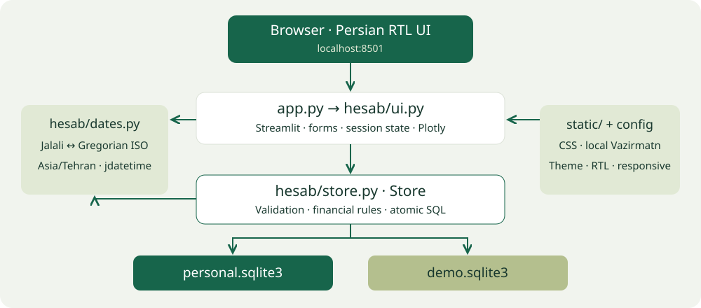
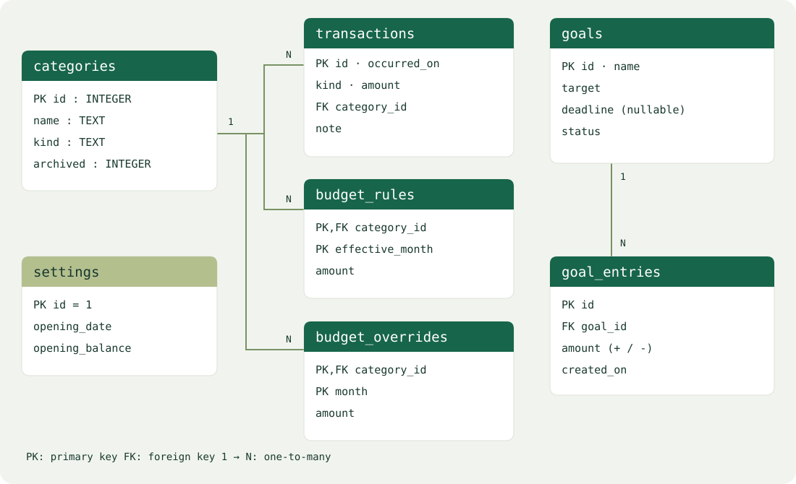
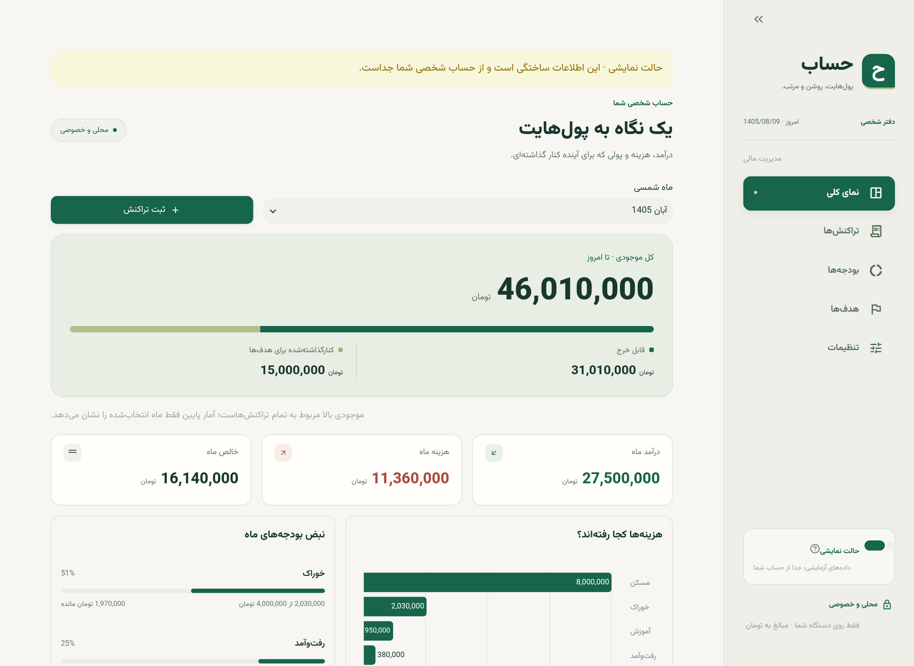
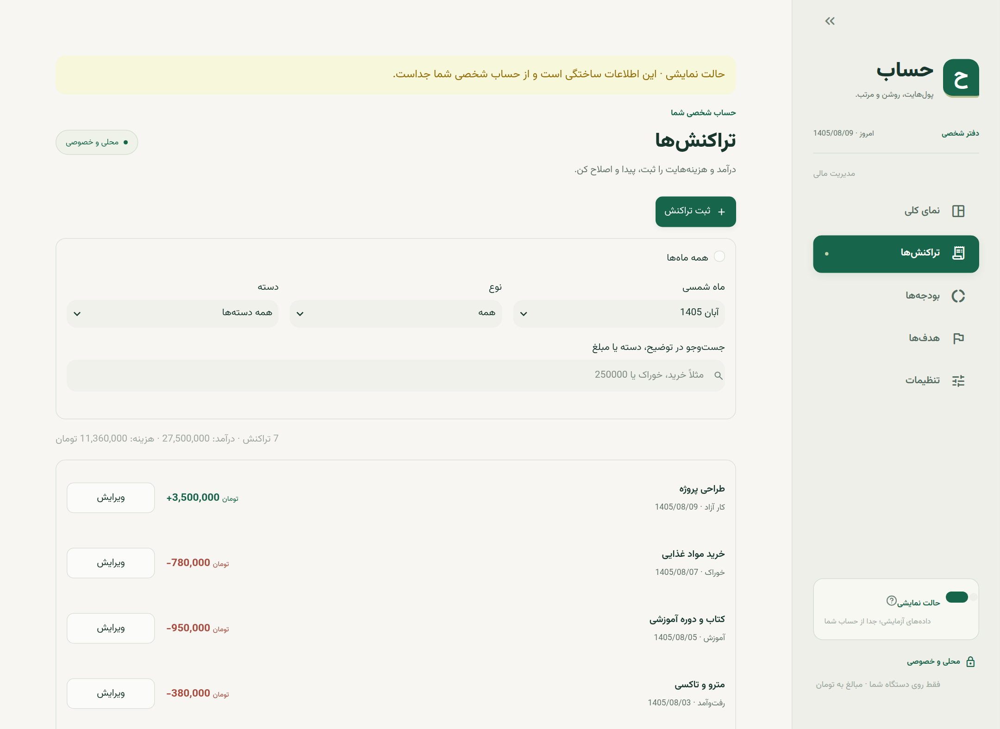
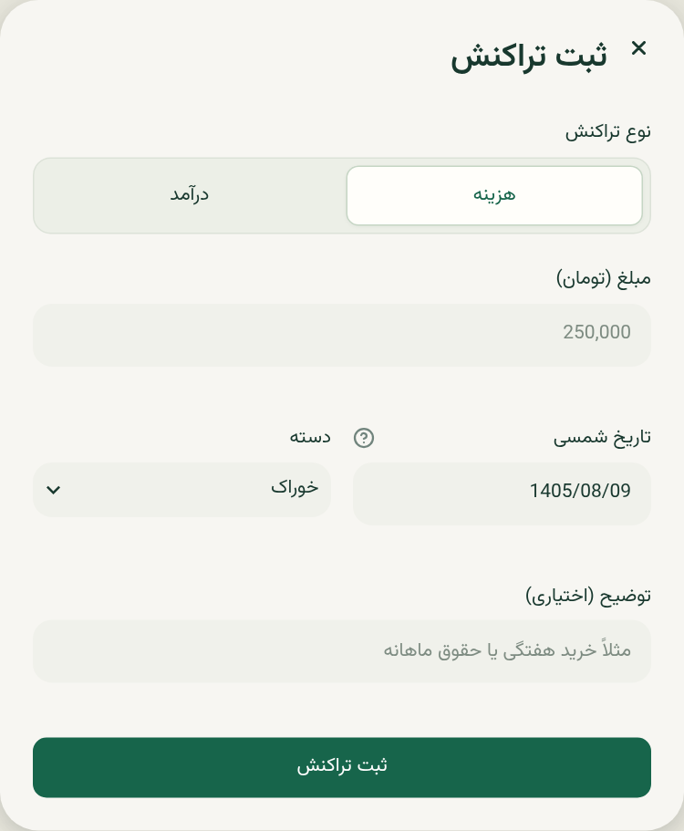
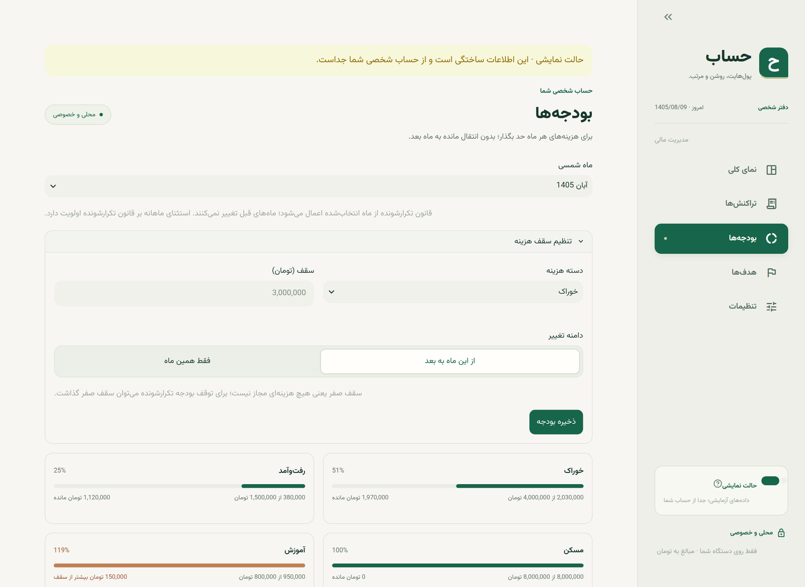
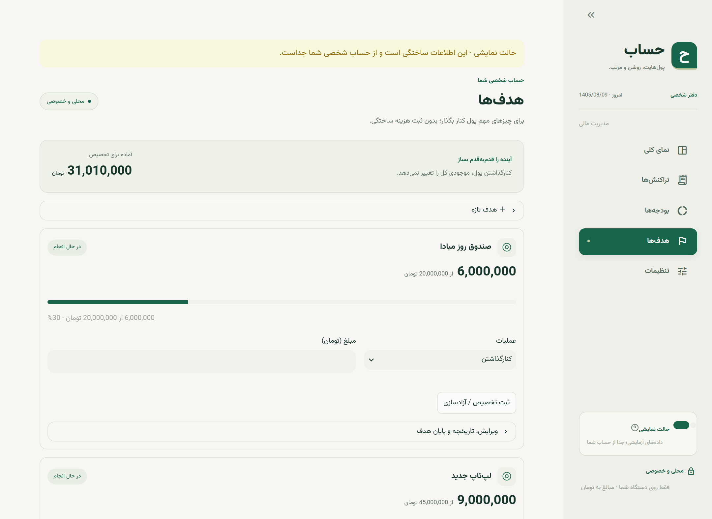
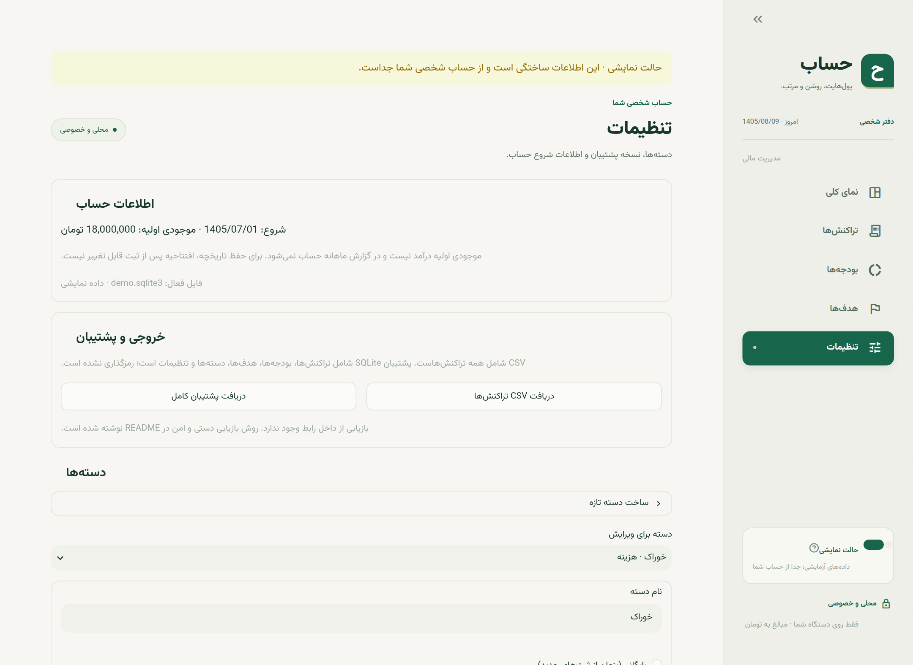

<link rel="stylesheet" href="../report/report.css">

<div class="cover">
<div><div class="eyebrow">دانشگاه آزاد واحد الکترونیکی</div><div class="badge">گزارش نهایی پروژه دانشگاهی · نسخه 0.1.0</div></div>
<div>
<h1>حساب</h1>
<h2>طراحی و پیاده‌سازی سامانه مدیریت مالی شخصی</h2>
<p class="subtitle">رابط فارسی، بودجه‌بندی شمسی و مدیریت هدف‌های پس‌انداز</p>
<div class="allocation"><i></i><i></i></div>
<p class="small">پول قابل خرج و پول کنارگذاشته‌شده؛ دو بخش از یک موجودی.</p>
<div class="meta">
<div><span>نام و نام خانوادگی</span><b>پیمان خسروی نژاد</b></div>
<div><span>نام استاد</span><b>پریسا رحمانی</b></div>
<div><span>عنوان درس</span><b>پروژه فناوری اطلاعات</b></div>
<div><span>شماره دانشجویی</span><b>40150341054309</b></div>
<div><span>شماره ترم / نیمسال تحصیلی</span><b>4043</b></div>
<div><span>تاریخ ارائه</span><b>1405/8/9</b></div>
</div>
</div>
<div class="cover-bottom"><span>Python · Streamlit · SQLite</span><span>محلی، تک‌کاربره و مستقل از خدمات بانکی</span></div>
</div>

<div class="page-break"></div>

<div class="eyebrow">راهنمای مطالعه</div>

# فهرست مطالب

<div class="toc">
<a href="#abstract">چکیده و شناسنامه پروژه <span>هدف، فناوری و دستاورد</span></a>
<a href="#requirements">1. تعریف مسئله و نیازمندی‌ها <span>محدوده و معیار پذیرش</span></a>
<a href="#domain">2. مدل مالی و قواعد کسب‌وکار <span>موجودی، بودجه و هدف</span></a>
<a href="#architecture">3. معماری و فناوری‌ها <span>لایه‌ها و چرخه اجرای برنامه</span></a>
<a href="#database">4. طراحی پایگاه داده <span>ERD، فرهنگ داده و قیود</span></a>
<a href="#algorithms">5. الگوریتم‌ها و جزئیات پیاده‌سازی <span>محاسبات، تقویم و هم‌زمانی</span></a>
<a href="#interface">6. رابط کاربری و راهنمای استفاده <span>تصاویر واقعی محیط نمایشی</span></a>
<a href="#security">7. امنیت، حریم خصوصی و پشتیبان <span>تهدیدها و بازیابی</span></a>
<a href="#quality">8. آزمون و ارزیابی <span>شواهد و محدودیت ارزیابی</span></a>
<a href="#execution">9. نصب، اجرا و نگهداری <span>تحویل و عیب‌یابی</span></a>
<a href="#conclusion">10. جمع‌بندی و توسعه آینده <span>محدودیت‌های نسخه موجود</span></a>
<a href="#sql">پیوست الف. اسکریپت ساخت پایگاه داده <span>DDL مطابق پیاده‌سازی</span></a>
<a href="#examples">پیوست ب. مثال‌های SQL و ردگیری نیازمندی‌ها <span>پرس‌وجوهای خواندنی</span></a>
<a href="#references">منابع <span>مستندات رسمی و کد پروژه</span></a>
</div>

> **یادداشت تحویل:** عبارت‌های داخل کروشه در صفحه عنوان را با مشخصات دانشجو و درس جایگزین کنید. تصاویر این گزارش فقط از **حالت نمایشی** تهیه شده‌اند و اطلاعات مالی شخصی نیستند. داده‌های نمایشی بر اساس روز اجرا ساخته می‌شوند؛ در نتیجه تاریخ‌ها و ارقام تصاویر ممکن است در اجرای دیگری متفاوت باشند.

<div class="page-break"></div>

<a id="abstract"></a>
<div class="eyebrow">معرفی پروژه</div>

# چکیده

«حساب» یک نرم‌افزار محلی برای مدیریت مالی شخصی است که با زبان Python، چارچوب Streamlit و پایگاه داده SQLite توسعه یافته است. مسئله اصلی پروژه، فراهم‌کردن تصویری روشن از درآمد، هزینه، وضعیت بودجه و پول کنارگذاشته‌شده برای هدف‌های آینده، با حداقل پیچیدگی عملیاتی است. رابط برنامه فارسی و راست‌به‌چپ است؛ تاریخ‌های رابط به تقویم هجری شمسی و مبالغ به تومان صحیح نمایش داده می‌شوند.

در این سامانه، مجموع پول نقد و حساب‌های بانکی کاربر به‌صورت یک موجودی واحد در نظر گرفته می‌شود. درآمد و هزینه، موجودی کل را تغییر می‌دهند؛ اما تخصیص به هدف پس‌انداز فقط بخشی از همین پول را رزرو می‌کند و هزینه محسوب نمی‌شود. این تفکیک از دوباره‌شماری هزینه جلوگیری می‌کند. بودجه‌ها نیز بر اساس ماه شمسی، با قواعد تکرارشونده و استثناهای ماهانه، محاسبه می‌شوند.

منطق مالی از رابط جدا شده است. عملیات حساس در تراکنش SQLite انجام می‌شوند و برای جلوگیری از تخصیص هم‌زمان یک موجودی، از قفل نوشتن زودهنگام استفاده شده است. داده شخصی و داده نمایشی در دو فایل مستقل نگهداری می‌شوند. امکان دریافت CSV تراکنش‌ها و پشتیبان کامل پایگاه داده نیز وجود دارد.

ارزیابی فعلی شامل 25 مورد آزمون موفق و پوشش 90.78% برای ماژول‌های مالی و تاریخ است. آزمون‌های مرورگر نیز برای چرخه ثبت، ویرایش و حذف، چیدمان واکنش‌گرا و رفتار نوار کناری در پروژه وجود دارند. این محصول برای استفاده تک‌کاربره روی لپ‌تاپ طراحی شده و سامانه بانکی یا حسابداری دوبل نیست.

**واژگان کلیدی:** مدیریت مالی شخصی، Streamlit، SQLite، بودجه‌بندی شمسی، پس‌انداز، رابط راست‌به‌چپ، تراکنش اتمیک.

## شناسنامه فنی

| ویژگی | مقدار |
|---|---|
| نام و نسخه | حساب / `hesab`، نسخه `0.1.0` |
| زبان و حداقل نسخه | Python 3.12 یا جدیدتر |
| رابط و نمودار | Streamlit `>=1.57,<2` و Plotly `>=7.1.0` |
| ذخیره‌سازی و تقویم | SQLite از کتابخانه استاندارد و jdatetime `>=6.1.1` |
| مدل اجرا | مرورگر روی `127.0.0.1:8501` و پردازش Python محلی |
| پایگاه داده | 7 جدول، نسخه ساختار `user_version = 1` |
| واحد پول / منطقه زمانی | تومان صحیح / `Asia/Tehran` |
| قلم و هویت بصری | Vazirmatn محلی، سبز تیره و زمینه روشن |

<div class="page-break"></div>

<a id="requirements"></a>
<div class="eyebrow">فصل اول</div>

# 1. تعریف مسئله و نیازمندی‌ها

## 1.1 مسئله و مخاطب

ثبت پراکنده هزینه‌ها در یادداشت یا فایل‌های جدا، تشخیص وضعیت واقعی پول را دشوار می‌کند. داشتن یک موجودی مثبت نیز لزوماً به معنای قابل خرج بودن تمام آن نیست؛ ممکن است بخشی از پول برای خرید لپ‌تاپ یا صندوق اضطراری کنار گذاشته شده باشد. پروژه برای یک کاربر فارسی‌زبان طراحی شده است که روی لپ‌تاپ شخصی خود، درآمد و هزینه را دستی ثبت می‌کند و به گزارش ماهانه شمسی نیاز دارد.

## 1.2 نیازمندی‌های عملکردی

| شناسه | نیازمندی | رفتار مورد انتظار |
|---|---|---|
| F01 | افتتاح حساب | ثبت یک‌باره تاریخ شروع و موجودی اولیه غیرمنفی |
| F02 | مدیریت تراکنش | ثبت، ویرایش، حذف با تأیید، جست‌وجو و فیلتر |
| F03 | نمای کلی | تفکیک موجودی کل، ذخیره هدف‌ها و قابل خرج؛ آمار ماه |
| F04 | بودجه | سقف هزینه هر دسته، قانون از یک ماه به بعد و استثنای یک‌ماهه |
| F05 | هدف پس‌انداز | ساخت، ویرایش، تخصیص، آزادسازی، تاریخچه و پایان هدف |
| F06 | دسته‌بندی | ساخت و تغییر نام دسته و بایگانی بدون حذف سوابق |
| F07 | خروجی | CSV همه تراکنش‌ها و پشتیبان کامل SQLite |
| F08 | نمایش امن | حساب نمایشی مستقل از حساب شخصی |

## 1.3 نیازمندی‌های غیرعملکردی

- **بومی‌سازی:** زبان فارسی، چیدمان RTL، تاریخ شمسی و رقم انگلیسی در خروجی؛ پذیرش ارقام فارسی و عربی در ورودی مبلغ و تاریخ.
- **دقت:** مبلغ صحیح و بدون اعشار شناور؛ محدودیت و اعتبارسنجی ورودی در لایه مالی.
- **پایداری:** ماندگاری داده پس از بستن مرورگر یا توقف برنامه؛ بازگردانی عملیات ناموفق.
- **حریم خصوصی:** استفاده محلی، قلم محلی و غیرفعال‌بودن آمار استفاده؛ عدم اتصال به بانک.
- **قابلیت استفاده:** طراحی مناسب لپ‌تاپ و تطبیق چیدمان در عرض‌های کوچک‌تر.
- **آزمون‌پذیری:** جداسازی منطق مالی از Streamlit، آزمون پایگاه داده موقت و کنترل مرورگری.

## 1.4 محدوده و معیار پذیرش

این نسخه فاقد ورود کاربران، چند حساب مستقل، چند ارز، اتصال بانکی، ورود CSV، تراکنش آینده یا تکرارشونده و استقرار عمومی است. معیار پذیرش آن، ثبت و ماندگاری صحیح رویدادها، رعایت روابط مالی، گزارش‌گیری ماه شمسی، حفاظت از داده شخصی هنگام نمایش و امکان خروجی‌گرفتن است. ادعای حسابرسی رسمی، انطباق بانکی یا عملکرد چندکاربره برای آن مطرح نمی‌شود.

<div class="page-break"></div>

<a id="domain"></a>
<div class="eyebrow">فصل دوم</div>

# 2. مدل مالی و قواعد کسب‌وکار

## 2.1 یک منبع پول، سه مقدار متفاوت

<div class="formula">موجودی کل = موجودی اولیه + مجموع درآمدها − مجموع هزینه‌ها<br>ذخیره هدف‌ها = مجموع تخصیص‌ها − مجموع آزادسازی‌ها<br>پول قابل خرج = موجودی کل − ذخیره هدف‌ها</div>

**موجودی اولیه درآمد نیست.** مبلغ افتتاحیه فقط نقطه شروع محاسبه موجودی است و به جمع درآمد ماه اضافه نمی‌شود. موجودی بالای داشبورد از تمام تراکنش‌ها محاسبه می‌شود؛ انتخاب ماه فقط آمار، نمودار و فهرست همان ماه را تغییر می‌دهد. داشبورد موجودی تاریخی پایان ماه را نمایش نمی‌دهد.

| گام در یک مثال فرضی | موجودی کل | ذخیره هدف | قابل خرج |
|---|---:|---:|---:|
| افتتاح حساب | 10,000,000 | 0 | 10,000,000 |
| ثبت درآمد 5,000,000 | 15,000,000 | 0 | 15,000,000 |
| ثبت هزینه 2,000,000 | 13,000,000 | 0 | 13,000,000 |
| تخصیص 4,000,000 به هدف | 13,000,000 | 4,000,000 | 9,000,000 |
| آزادسازی 1,000,000 | 13,000,000 | 3,000,000 | 10,000,000 |

## 2.2 قواعد تراکنش و دسته

تراکنش، درآمد یا هزینه با مبلغ مثبت است؛ علامت اثر آن از نوع تراکنش تعیین می‌شود. تاریخ باید بین تاریخ افتتاح حساب و امروز، با احتساب دو مرز، باشد. دسته انتخاب‌شده باید با نوع تراکنش یکسان باشد. دسته بایگانی‌شده برای ثبت جدید قابل استفاده نیست، ولی ویرایش تراکنش قبلی با حفظ همان دسته مجاز است. تغییر نام دسته در نمایش سوابق قبلی نیز دیده می‌شود؛ نام قدیمی جداگانه ذخیره نمی‌شود.

ثبت رویداد واقعی حتی اگر موجودی را منفی کند مجاز است. برنامه هشدار می‌دهد، اما تراکنش را به دلیل کسری رد نمی‌کند و ذخیره هدف‌ها را خودکار کم نمی‌کند. حذف و ویرایش، محاسبات بعدی موجودی و بودجه را تغییر می‌دهند؛ نسخه‌های قبلی تراکنش در جدول حسابرسی جدا ثبت نمی‌شوند.

## 2.3 قواعد هدف پس‌انداز

تخصیص، خروج واقعی پول نیست. تخصیص جدید نباید از پول قابل خرج یا مانده مبلغ هدف بیشتر باشد. آزادسازی نباید از ذخیره همان هدف بیشتر شود. کاهش مبلغ هدف به کمتر از ذخیره موجود مجاز نیست. مهلت هدف جدید نمی‌تواند گذشته باشد؛ عبور از مهلت فقط اطلاع‌رسانی می‌شود و هدف خودکار بسته نمی‌شود.

هدف سه وضعیت `active`، `completed` و `archived` دارد. پیش از پایان هدف، ذخیره آن باید صفر شود. تکمیل هدف درآمد یا هزینه ایجاد نمی‌کند؛ برای خرید واقعی، ابتدا مبلغ لازم را آزاد و سپس هزینه خرید را جدا ثبت می‌کنیم. تاریخچه تخصیص و آزادسازی پس از پایان هدف حفظ می‌شود.

<div class="page-break"></div>

<div class="eyebrow">فصل دوم · ادامه</div>

# 2.4 منطق بودجه‌بندی ماهانه

بودجه یک **سقف نظارتی** است، نه برداشت از موجودی. فقط هزینه‌های یک دسته در ماه شمسی انتخاب‌شده در مصرف بودجه اثر دارند. سقف درآمد تعریف نمی‌شود و تخصیص هدف نیز در هزینه بودجه وارد نمی‌شود. عبور از سقف باعث هشدار می‌شود، نه ممنوعیت ثبت هزینه.

## اولویت انتخاب سقف

1. اگر برای دسته و ماه مورد نظر استثنا وجود داشته باشد، همان مقدار انتخاب می‌شود.
2. در غیر این صورت، جدیدترین قانون تکرارشونده با ماه اثرگذاری کوچک‌تر یا مساوی ماه مورد نظر استفاده می‌شود.
3. اگر هیچ‌کدام نباشد، بودجه آن دسته «تنظیم نشده» است.

| ماه فرضی | قانون یا استثنا | سقف مؤثر خوراک |
|---|---|---:|
| `1404-01` | شروع قانون تکرارشونده 3,000,000 | 3,000,000 |
| `1404-02` | استثنای همین ماه 4,000,000 | 4,000,000 |
| `1404-03` | بدون تغییر | 3,000,000 |
| `1404-04` | شروع قانون جدید 3,500,000 | 3,500,000 |
| `1404-05` | ادامه قانون جدید | 3,500,000 |

حذف استثنای اردیبهشت، سقف آن ماه را به قانون پایه 3,000,000 برمی‌گرداند. تعریف قانون تیر، ماه‌های قبل از تیر را بازنویسی نمی‌کند. البته اگر خود کاربر قانونی را برای یک ماه قدیمی ثبت یا ویرایش کند، محاسبه همان ماه و ماه‌های بعد تا قانون بعدی تغییر خواهد کرد؛ این مدل دفتر ثبت تغییرات غیرقابل‌ویرایش نیست.

## صفر با نبود بودجه تفاوت دارد

- **سقف صفر:** بودجه وجود دارد و هر هزینه مثبت، عبور از سقف است.
- **بدون سقف:** بودجه‌ای برای دسته تعریف نشده است؛ برنامه هزینه بدون سقف را جدا معرفی می‌کند.
- **عدم انتقال مانده:** مبلغ مصرف‌نشده به ماه بعد منتقل نمی‌شود.
- **سقف‌های مستقل:** برنامه مجموع سقف‌ها را با موجودی محدود نمی‌کند؛ بودجه‌بندی، تخصیص واقعی پول نیست.

<div class="formula">مصرف بودجه = مجموع هزینه‌های دسته در بازه ماه شمسی<br>مانده سقف = سقف مؤثر − مصرف بودجه</div>

نوار پیشرفت برای خوانایی در 100% متوقف می‌شود، ولی درصد و مبلغ اضافه‌خرج می‌توانند عبور واقعی از سقف را نشان دهند. در سقف صفر، تقسیم بر صفر انجام نمی‌شود و برچسب مخصوص نمایش داده می‌شود.

<div class="page-break"></div>

<a id="architecture"></a>
<div class="eyebrow">فصل سوم</div>

# 3. معماری و فناوری‌ها

<figure><figcaption>شکل 1 — معماری محلی. در هر اجرا، فقط یکی از فایل‌های شخصی یا نمایشی به‌عنوان مخزن فعال انتخاب می‌شود.</figcaption></figure>

## 3.1 مسئولیت اجزا

| جزء | مسئولیت و دلیل جداسازی |
|---|---|
| `app.py` | نقطه ورود کوتاه؛ فراخوانی تابع اصلی رابط |
| `hesab/ui.py` | صفحه‌ها، فرم‌ها، دیالوگ‌ها، پیام‌ها، قالب‌بندی و نمودار |
| `hesab/store.py` | اعتبارسنجی مالی، دسترسی SQLite، محاسبات، CSV و پشتیبان؛ بدون وابستگی به Streamlit |
| `hesab/dates.py` | تبدیل تاریخ، ارقام، مرز ماه شمسی و روز جاری تهران |
| `.streamlit/config.toml` | آدرس محلی، غیرفعال‌کردن آمار استفاده، رنگ و قلم |
| `static/` | CSS واکنش‌گرا و RTL، قلم Vazirmatn و مجوز آن |
| `tests/` | آزمون قواعد، رابط درون‌پردازشی و بررسی مرورگر |

## 3.2 چرایی انتخاب فناوری

**Streamlit** امکان ساخت رابط تعاملی مستقیماً در Python را فراهم می‌کند؛ برای این پروژه کوچک به frontend و REST API مستقل نیازی نیست. هزینه این سادگی، وابستگی رفتار رابط به چرخه بازاجرا و محدودتر بودن کنترل جزئی بر DOM است. **SQLite** سرور جدا نیاز ندارد و تراکنش و کلید خارجی دارد؛ برای نوشتن پرترافیک چندکاربره انتخاب این نسخه نیست. **Plotly** نمودار میله‌ای تعاملی هزینه‌ها را می‌سازد و **jdatetime** تبدیل تقویم و تشخیص روز معتبر را انجام می‌دهد. **uv** وابستگی‌ها و فایل قفل محیط را مدیریت می‌کند.

<div class="page-break"></div>

<div class="eyebrow">فصل سوم · ادامه</div>

# 3.3 چرخه اجرا و جریان داده

1. `app.py` تابع `main()` رابط را اجرا می‌کند. تنظیمات صفحه، CSS و نوار کناری ساخته می‌شوند.
2. نوع حساب از کلید حالت نمایشی تعیین می‌شود و `Store` برای فایل متناظر ساخته می‌شود.
3. ساختار پایگاه داده با `CREATE TABLE IF NOT EXISTS` بررسی می‌شود. دسته‌های اولیه فقط وقتی جدول دسته خالی باشد درج می‌شوند.
4. در حالت نمایشی، `seed_demo()` فقط اگر افتتاحیه موجود نباشد داده می‌سازد؛ هر بار اجرا داده‌ها را تکرار یا بازنشانی نمی‌کند.
5. اگر افتتاحیه وجود نداشته باشد فرم شروع نمایش داده می‌شود؛ در غیر این صورت هشدارها و صفحه انتخاب‌شده رندر می‌شوند.
6. کاربر فرم را ارسال می‌کند؛ رابط ورودی تاریخ و مبلغ را تبدیل و عملیات مناسب `Store` را فراخوانی می‌کند.
7. `Store` قواعد را کنترل و SQL پارامتری را در تراکنش اجرا می‌کند؛ در موفقیت `commit` و در خطا `rollback` انجام می‌شود.
8. پیام موفقیت در `session_state` قرار می‌گیرد و `st.rerun()` باعث بازسازی رابط با داده جدید می‌شود.

## مدیریت وضعیت رابط

تغییر ویجت‌ها می‌تواند اسکریپت Streamlit را دوباره اجرا کند. فرم‌ها با `st.form` ورودی‌های مرتبط را تا لحظه ارسال گروه‌بندی می‌کنند؛ بنابراین هر تغییر متن الزاماً عملیات مالی ایجاد نمی‌کند. نوع تراکنش خارج فرم قرار دارد تا فهرست دسته‌های درآمد و هزینه پیش از ارسال تغییر کند. ثبت و ویرایش در `st.dialog` انجام می‌شوند.

`st.session_state` انتخاب صفحه، مقادیر ویجت‌ها و پیام یک‌باره موفقیت را نگه می‌دارد؛ این بخش جایگزین ذخیره‌سازی دائمی نیست. منبع نهایی اطلاعات مالی SQLite است. هنگام جابه‌جایی میان شخصی و نمایشی، کلیدهای پیش‌نویس تراکنش و هدف پاک می‌شوند تا مقادیر فرم بین دو حالت منتقل نشوند.

## جریان یک ثبت نمونه

```text
text amount + Jalali date + category
  → amount_value() + parse_jalali()
  → Store.save_transaction()
  → validate dates / category / positive integer
  → BEGIN IMMEDIATE → INSERT with parameters → COMMIT
  → notice() → st.rerun() → updated balances and chart
```

استفاده از `FinanceError`، که زیرکلاس `ValueError` است، امکان نمایش خطاهای اعتبارسنجی به زبان قابل فهم را فراهم می‌کند. خطاهای زیرساختی مانند نبود مجوز فایل، لزوماً به پیام تجاری تبدیل نشده‌اند و باید در لایه اجرا بررسی شوند.

<div class="page-break"></div>

<a id="database"></a>
<div class="eyebrow">فصل چهارم</div>

# 4. طراحی پایگاه داده

<figure><figcaption>شکل 2 — نمودار رابطه موجودیت‌ها. اتصال‌ها، رابطه‌های کلید خارجی واقعی هستند؛ settings رکورد مستقل افتتاحیه است.</figcaption></figure>

## 4.1 قواعد عمومی ساختار

هر فایل SQLite یک حساب کامل و مستقل است. جدول کاربر یا حساب بانکی وجود ندارد. شناسه‌ها `INTEGER PRIMARY KEY` هستند؛ در SQLite، در صورت تعیین‌نکردن شناسه، مقدار خودکار ایجاد می‌شود، اما کلیدواژه `AUTOINCREMENT` استفاده نشده است. مقادیر نوع و وضعیت رشته‌های کنترل‌شده انگلیسی هستند؛ ترجمه در رابط انجام می‌شود.

مبالغ مالی همگی عدد صحیح‌اند. تاریخ روز در قالب میلادی `YYYY-MM-DD` ذخیره می‌شود، ولی کلید ماه بودجه، **ماه شمسی** با قالب `YYYY-MM` است. نباید `effective_month` یا `month` را ماه میلادی تفسیر کرد. `PRAGMA user_version = 1` شماره ساختار فعلی است؛ چارچوب مهاجرت نسخه‌ای در این نسخه وجود ندارد.

<div class="page-break"></div>

<div class="eyebrow">فصل چهارم · فرهنگ داده</div>

# 4.2 افتتاحیه، دسته‌ها و تراکنش‌ها

## جدول `settings`

| ستون | نوع / قید | شرح |
|---|---|---|
| `id` | INTEGER، کلید اصلی، `CHECK(id=1)` | حداکثر یک رکورد افتتاحیه |
| `opening_date` | TEXT، NOT NULL | تاریخ شروع میلادی ISO |
| `opening_balance` | INTEGER، NOT NULL، `>=0` | موجودی روز شروع به تومان |

وجود دقیقاً یک رکورد پس از راه‌اندازی از مسیر `setup()` کنترل می‌شود. جدول پیش از شروع می‌تواند خالی باشد. افتتاحیه از رابط پس از ثبت قابل تغییر نیست.

## جدول `categories`

| ستون | نوع / قید | شرح |
|---|---|---|
| `id` | INTEGER، کلید اصلی | شناسه دسته |
| `name` | TEXT، NOT NULL | نام؛ طول 1 تا 80 در برنامه کنترل می‌شود |
| `kind` | TEXT، NOT NULL، `income/expense` | نوع ثابت دسته |
| `archived` | INTEGER، NOT NULL، پیش‌فرض 0 | فقط 0 یا 1؛ بایگانی به جای حذف |

قید `UNIQUE(name,kind)` مانع نام تکراری برای یک نوع می‌شود؛ یک نام می‌تواند برای درآمد و هزینه جدا وجود داشته باشد. مقایسه نام بر اساس رفتار پیش‌فرض SQLite است و نرمال‌سازی جامع حروف فارسی/عربی یا فاصله مجازی انجام نمی‌شود.

## جدول `transactions`

| ستون | نوع / قید | شرح |
|---|---|---|
| `id` | INTEGER، کلید اصلی | شناسه تراکنش |
| `occurred_on` | TEXT، NOT NULL | روز وقوع در قالب ISO میلادی |
| `kind` | TEXT، NOT NULL، `income/expense` | تعیین علامت اثر روی موجودی |
| `amount` | INTEGER، NOT NULL، `>0` | مبلغ مثبت صحیح، به تومان |
| `category_id` | INTEGER، NOT NULL، FK | ارجاع به `categories.id` |
| `note` | TEXT، NOT NULL، پیش‌فرض رشته خالی | توضیح اختیاری؛ حداکثر 300 نویسه در برنامه |

شاخص `transactions_date` روی `occurred_on` برای جست‌وجوی بازه زمانی ساخته شده است. سازگاری نوع دسته با تراکنش، معتبر بودن تاریخ و ممنوعیت استفاده جدید از دسته بایگانی‌شده در کد `Store` کنترل می‌شوند، نه با trigger پایگاه داده.

<div class="page-break"></div>

<div class="eyebrow">فصل چهارم · فرهنگ داده</div>

# 4.3 بودجه‌ها، هدف‌ها و تاریخچه

<div class="compact-schema">

## جدول `budget_rules`

| ستون | نوع / قید | شرح |
|---|---|---|
| `category_id` | INTEGER، NOT NULL، FK و بخشی از PK | دسته هزینه |
| `effective_month` | TEXT، NOT NULL، بخشی از PK | ماه شروع شمسی مثل `1405-08` |
| `amount` | INTEGER، NOT NULL، `>=0` | سقف معتبر تا قانون بعدی |

کلید اصلی مرکب `(category_id,effective_month)` هر نسخه بودجه را یکتا می‌کند. ثبت دوباره همان کلید با `ON CONFLICT ... DO UPDATE` مقدار آن نسخه را به‌روز می‌کند.

## جدول `budget_overrides`

| ستون | نوع / قید | شرح |
|---|---|---|
| `category_id` | INTEGER، NOT NULL، FK و بخشی از PK | دسته هزینه |
| `month` | TEXT، NOT NULL، بخشی از PK | ماه شمسی دقیق استثنا |
| `amount` | INTEGER، NOT NULL، `>=0` | سقف جایگزین همان ماه |

کلید اصلی `(category_id,month)` است. نبود رکورد به معنای بازگشت به قانون پایه است، نه سقف صفر.

## جدول `goals`

| ستون | نوع / قید | شرح |
|---|---|---|
| `id` | INTEGER، کلید اصلی | شناسه هدف |
| `name` | TEXT، NOT NULL | عنوان؛ طول 1 تا 80 در برنامه |
| `target` | INTEGER، NOT NULL، `>0` | مبلغ هدف به تومان |
| `deadline` | TEXT، nullable | مهلت اختیاری میلادی ISO |
| `status` | TEXT، NOT NULL، پیش‌فرض `active` | یکی از active / completed / archived |

## جدول `goal_entries`

| ستون | نوع / قید | شرح |
|---|---|---|
| `id` | INTEGER، کلید اصلی | شناسه رویداد تخصیص |
| `goal_id` | INTEGER، NOT NULL، FK | ارجاع به `goals.id` |
| `amount` | INTEGER، NOT NULL، `!=0` | مثبت: تخصیص؛ منفی: آزادسازی |
| `created_on` | TEXT، NOT NULL | روز ثبت بر اساس امروز تهران، بدون ساعت |

ذخیره فعلی یک هدف از `SUM(amount)` به دست می‌آید؛ ستون مانده ذخیره‌شده وجود ندارد. برای روابط حذف آبشاری تعریف نشده است. حذف مستقیم هدف یا دسته دارای وابستگی با کلید خارجی فعال مجاز نیست؛ مسیر رابط برای آنها پایان/بایگانی است.

</div>

<div class="page-break"></div>

<a id="algorithms"></a>
<div class="eyebrow">فصل پنجم</div>

# 5. الگوریتم‌ها و جزئیات پیاده‌سازی

## 5.1 دقت پول و اعتبارسنجی

تابع `amount_value()` رقم فارسی و عربی را به لاتین تبدیل می‌کند، فاصله ابتدا و انتها و جداکننده‌های `,` و `٬` را حذف می‌کند، سپس فقط رقم ASCII را می‌پذیرد. اعشار، عدد منفی، نمایش علمی مثل `1e6` و ورودی خالی رد می‌شوند. حداکثر مبلغ هر ورودی **9,000,000,000,000 تومان** است. صفر فقط برای افتتاحیه و بودجه با `allow_zero=True` مجاز است. ستون‌های مبلغ در پایگاه داده نیز قید علامت دارند، اما سقف مبلغ، طول متن و همه قواعد ترکیبی فقط در لایه برنامه اعمال می‌شوند.

استفاده از integer خطای اعشار شناور در محاسبات پول را حذف می‌کند. نسبت‌ها و درصدهای نمایشی از تقسیم استفاده می‌کنند، اما در مبلغ ثبت‌شده اثر ندارند. این برنامه چندارزی یا دارای مبلغ اعشاری نیست.

## 5.2 تاریخ شمسی و بازه نیمه‌باز

`parse_jalali()` ورودی را به سه بخش سال، ماه و روز تبدیل می‌کند، سال بین 1200 تا 1600 را می‌پذیرد و اعتبار روز را به jdatetime می‌سپارد. رقم‌های فارسی/عربی و جداکننده `-` نیز پذیرفته می‌شوند. تبدیل برای نمایش از مسیر عکس، در `jalali()` انجام می‌شود. روز جاری با `ZoneInfo("Asia/Tehran")` محاسبه می‌شود، نه صرفاً منطقه زمانی پیش‌فرض سیستم.

برای گزارش ماهانه، ابتدای ماه شمسی و ابتدای ماه شمسی بعد به میلادی تبدیل می‌شوند:

```sql
WHERE occurred_on >= :start_iso
  AND occurred_on <  :next_month_start_iso
```

بازه نیمه‌باز، روز آخر ماه را بدون محاسبه دستی تعداد روزها پوشش می‌دهد. برای نمونه، اسفند 1399 دارای 30 روز و اسفند 1400 دارای 29 روز است؛ هر دو در آزمون بررسی شده‌اند. مقایسه رشته‌ای تاریخ ISO معتبر و صفرپُرشده با ترتیب زمانی سازگار است.

## 5.3 محاسبه موجودی و جلوگیری از داده مشتق تکراری

تابع `_balances()` جمع درآمد منهای هزینه را با `CASE` و `SUM` محاسبه و به افتتاحیه اضافه می‌کند. ذخیره هدف‌ها نیز از مجموع رویدادهای تخصیص استخراج می‌شود. برای مجموعه خالی، `COALESCE(...,0)` نتیجه صفر می‌دهد. ذخیره‌نکردن مانده به شکل ستون جدا، نیاز به همگام‌کردن چند مقدار هنگام ویرایش یا حذف تراکنش را کاهش می‌دهد.

<div class="page-break"></div>

<div class="eyebrow">فصل پنجم · ادامه</div>

# 5.4 اتمیک‌بودن و تخصیص هم‌زمان

تمام اتصال‌های `Store.connection()` با `timeout=15` ساخته می‌شوند و کلیدهای خارجی در همان اتصال فعال می‌شوند. سپس `BEGIN IMMEDIATE` پیش از خواندن و نوشتن اجرا می‌شود. در پایان موفق، `commit` و در هر استثنا، `rollback` و بستن اتصال انجام می‌شود.

در تخصیص پول هدف، بررسی «آیا موجودی کافی است؟» و ثبت رویداد باید در یک تراکنش باشند. اگر دو تب، هر کدام 8,000 تومان از موجودی قابل خرج 10,000 تومان بخواهند، نباید هر دو مقدار قدیمی را بخوانند و 16,000 تومان رزرو کنند. تراکنش دوم پس از پایان اول، موجودی جدید را می‌بیند و تخصیص دوم رد می‌شود. آزمون دو رشته هم‌زمان این وضعیت را بررسی می‌کند.

```text
BEGIN IMMEDIATE
  read active goal
  calculate reserved and available
  validate release / available / target
  insert signed goal entry
COMMIT
```

**موازنه طراحی:** حتی پرس‌وجوهای خواندنی این کلاس از همین context manager عبور می‌کنند و قفل رزروشده نوشتن می‌گیرند. این انتخاب برای برنامه محلی کوچک ساده است، ولی هم‌زمانی خواندن/نوشتن را محدود می‌کند. WAL، connection pool یا سرور پایگاه داده در این نسخه پیکربندی نشده‌اند. این رفتار، تضمین کارایی چندکاربره نیست.

## 5.5 فیلتر، مرتب‌سازی و هزینه محاسبات

فیلتر ماه، نوع و دسته با SQL پارامتری اجرا می‌شود. نتایج با روز وقوع نزولی و سپس شناسه نزولی مرتب می‌شوند. جست‌وجو در توضیح، نام دسته و مبلغ، پس از دریافت نتایج در Python و با `casefold()` انجام می‌شود؛ جست‌وجوی تمام‌متن SQLite وجود ندارد.

صفحه‌بندی رابط، 20 تراکنش در هر صفحه نشان می‌دهد، اما کل نتیجه فیلترشده ابتدا در حافظه بارگذاری می‌شود؛ صفحه‌بندی SQL مبتنی بر `LIMIT/OFFSET` نیست. در محاسبه بودجه نیز برای هر دسته چند پرس‌وجو اجرا می‌شود. این روش برای داده شخصی کم‌حجم مناسب است، اما برای داده بزرگ باید با سنجش واقعی، تجمیع SQL، شاخص‌های تکمیلی و صفحه‌بندی سمت پایگاه داده بهبود یابد. آزمون بار یا benchmark رسمی برای این نسخه انجام نشده است.

<div class="page-break"></div>

<a id="interface"></a>
<div class="eyebrow">فصل ششم</div>

# 6. رابط کاربری و راهنمای استفاده

## 6.1 نمای کلی

<figure><figcaption>شکل 3 — موجودی کل و نوار تخصیص، آمار ماه، نمودار هزینه و وضعیت بودجه. تصویر واقعی از داده ساختگی.</figcaption></figure>

نوار سبز اصلی و بخش روشن‌تر، تمایز «قابل خرج» و «ذخیره هدف‌ها» را نشان می‌دهند. این عنصر امضای بصری برنامه است و یک مفهوم واقعی را منتقل می‌کند. در زیر آن، درآمد، هزینه و خالص ماه انتخاب‌شده دیده می‌شود. نمودار میله‌ای برای مقایسه مبلغ دسته‌ها و نوار بودجه برای تشخیص مانده یا اضافه‌خرج استفاده شده است.

صفحه با انتخاب ماه، گزارش ماهانه را تغییر می‌دهد؛ موجودی کل بالای صفحه همچنان بر اساس تمام تراکنش‌های ثبت‌شده است. در حالت بدون داده، پیام راهنما به جای نمودار خالی نمایش داده می‌شود. هشدار زرد حالت نمایشی نشان می‌دهد که اطلاعات شخصی در تصویر وجود ندارد.

<div class="page-break"></div>

<div class="eyebrow">فصل ششم · تراکنش‌ها</div>

# 6.2 ثبت و پیدا کردن تراکنش

<figure><figcaption>شکل 4 — فیلتر ماه، نوع و دسته، جست‌وجو و ورود به ویرایش.</figcaption></figure>

1. از «ثبت تراکنش»، نوع درآمد یا هزینه را انتخاب کنید.
2. مبلغ تومان، تاریخ شمسی و دسته متناسب را وارد کنید؛ توضیح اختیاری است.
3. پس از ثبت موفق، آمار از داده جدید محاسبه می‌شود.
4. برای اصلاح، در فهرست روی «ویرایش» بزنید. حذف فقط پس از فعال‌کردن تأیید انجام می‌شود.

<div class="two-col">
<figure><figcaption>شکل 5 — فرم ثبت با ورودی‌های مبلغ، تاریخ و دسته.</figcaption></figure>
<div><h3>نکات تجربه کاربری</h3><p>رنگ و علامت مثبت/منفی همراه هم، درآمد و هزینه را متمایز می‌کنند. فاصله ثابت راهنمای زیر ورودی‌ها مانع هم‌پوشانی متن و جابه‌جایی دکمه ثبت می‌شود. گزینه‌های نوع تراکنش روی یک ردیف باقی می‌مانند. خطای ورودی، توضیح فارسی و قابل اقدام دارد.</p></div>
</div>

<div class="page-break"></div>

<div class="eyebrow">فصل ششم · برنامه‌ریزی</div>

# 6.3 بودجه‌های ماهانه

<figure><figcaption>شکل 6 — تنظیم دامنه تغییر بودجه و کارت‌های وضعیت هر دسته.</figcaption></figure>

در صفحه بودجه ابتدا ماه شمسی، دسته هزینه و سقف تومان انتخاب می‌شوند. گزینه «از این ماه به بعد» قانون تکرارشونده و «فقط همین ماه» استثنا می‌سازد. برای استثنا، دکمه بازگشت به قانون پایه وجود دارد. سقف صفر برای منع نظارتی هزینه در آن دسته است؛ ثبت هزینه واقعی همچنان ممکن است.

نوار پیشرفت و متن «مانده» یا «بیشتر از سقف» وضعیت را روشن می‌کنند. دسته بایگانی‌شده اگر سقف یا هزینه مرتبط داشته باشد همچنان در محاسبات بودجه دیده می‌شود تا بایگانی تاریخچه را پنهان نکند. دسته‌ای که هزینه دارد ولی سقفی ندارد، با پیام جدا معرفی می‌شود.

<div class="page-break"></div>

<div class="eyebrow">فصل ششم · پس‌انداز</div>

# 6.4 هدف‌ها و تخصیص پول

<figure><figcaption>شکل 7 — هدف‌های ساختگی، درصد پیشرفت و عملیات کنارگذاشتن یا آزادسازی.</figcaption></figure>

از «هدف تازه» نام، مبلغ و در صورت نیاز مهلت شمسی ثبت می‌شود. در کارت هدف، مبلغ فعلی، مبلغ مقصد و درصد پیشرفت نمایش داده می‌شود. عملیات «کنارگذاشتن» موجودی قابل خرج را کاهش و «آزادسازی» آن را افزایش می‌دهد؛ در هر دو حالت موجودی کل ثابت می‌ماند.

بخش بازشونده هر هدف، ویرایش، تاریخچه و پایان آن را در اختیار کاربر می‌گذارد. برای تکمیل یا بایگانی، ابتدا ذخیره باید صفر و سپس تأیید پایان فعال شود. ذخیره هدف با گذشت زمان یا رسیدن به مبلغ هدف خودکار به هزینه تبدیل نمی‌شود. فهرست هدف‌های پایان‌یافته برای مراجعه بعدی حفظ می‌شود.

<div class="page-break"></div>

<div class="eyebrow">فصل ششم · تنظیمات و طراحی</div>

# 6.5 تنظیمات، دسته‌ها و هویت بصری

<figure><figcaption>شکل 8 — افتتاحیه، نام فایل فعال، CSV، پشتیبان کامل و مدیریت دسته‌ها.</figcaption></figure>

تنظیمات اطلاعات افتتاحیه و نوع فایل فعال را نشان می‌دهد. ساخت دسته، تغییر نام و بایگانی از همین صفحه انجام می‌شوند. برای حفظ ارتباط سوابق، حذف دسته از رابط ارائه نشده است. CSV برای بررسی تراکنش‌ها در صفحه‌گسترده و پشتیبان SQLite برای نگهداری کل حساب است.

## اصول طراحی اجراشده

رنگ اصلی `#17654B`، جوهر `#18382E`، زمینه `#F7F6F2` و سبز ذخیره `#B4BF8E` هستند. قلم محلی Vazirmatn برای متن و عنوان با وزن‌های متفاوت استفاده می‌شود. اعداد جهت مستقل چپ‌به‌راست دارند تا مبلغ و تاریخ در متن فارسی به‌هم نریزند. نوار کناری دارای گزینه‌های تمام‌عرض، وضعیت انتخاب سبز، آیکون و کنترل با صفحه‌کلید است. چیدمان در عرض‌های 1366، 768 و 390 پیکسل بررسی شده است؛ طراحی همچنان لپ‌تاپ‌محور است و ادعای ممیزی کامل دسترس‌پذیری ندارد.

<div class="page-break"></div>

<a id="security"></a>
<div class="eyebrow">فصل هفتم</div>

# 7. امنیت، حریم خصوصی و پشتیبان

## 7.1 مدل تهدید و کنترل‌ها

| ریسک | کنترل موجود | محدودیت باقی‌مانده |
|---|---|---|
| تزریق SQL از ورودی | پارامترهای `?` و مقادیر جدا از متن SQL | ویرایش مستقیم فایل خارج از کنترل برنامه است |
| تزریق HTML در متن کاربر | `html.escape` پیش از قرار دادن متن در HTML سفارشی | جایگزین سیاست امنیتی سامانه عمومی نیست |
| فرمول مخرب در CSV | پیشوند تک‌نقل‌قول برای متن‌های حساس در دسته و توضیح | محافظت اولیه است؛ رفتار نرم‌افزار مقصد باید بررسی شود |
| تخصیص هم‌زمان بیش از موجودی | بررسی و درج در یک `BEGIN IMMEDIATE` | قفل نوشتن، ظرفیت هم‌زمانی را محدود می‌کند |
| نمایش ناخواسته داده شخصی | فایل نمایشی مستقل و هشدار واضح | کاربر باید حالت نمایشی را پیش از ارائه روشن کند |
| دسترسی شبکه ناخواسته | اتصال پیش‌فرض به `127.0.0.1` | تغییر پیکربندی می‌تواند سرویس را عمومی کند |
| خواندن فایل دستگاه | هشدار صریح رمزگذاری‌نشدن | رمزگذاری و احراز هویت برنامه وجود ندارد |

در `.streamlit/config.toml`، جمع‌آوری آمار استفاده غیرفعال است و قلم از فایل محلی سرو می‌شود. برنامه هیچ اتصال بانکی یا همگام‌سازی ابری ندارد. پس از نصب وابستگی‌ها برای کار اصلی به اینترنت نیاز ندارد؛ این ویژگی معادل رمزگذاری اطلاعات نیست.

## 7.2 تفاوت خروجی‌ها

**CSV:** همه تراکنش‌ها، مستقل از فیلتر صفحه، با شناسه، تاریخ شمسی، نوع فارسی، مبلغ، دسته و توضیح صادر می‌شوند. فایل با `utf-8-sig` و BOM برای سازگاری بهتر با متن فارسی در ابزارهای صفحه‌گسترده تولید می‌شود. بودجه، هدف و افتتاحیه در CSV نیستند و قابلیت ورود مجدد CSV وجود ندارد.

**پشتیبان کامل:** `sqlite3.Connection.backup()` یک تصویر سازگار را در پایگاه داده حافظه‌ای می‌سازد و `serialize()` آن را به بایت تبدیل می‌کند. این روش، کپی ساده فایل در هنگام نوشتن نیست. تمام هفت جدول در خروجی هستند، اما کد برنامه، قلم و وابستگی‌ها نیستند. نسخه پشتیبان رمزگذاری نشده است و باید در محل امن نگهداری شود.

## 7.3 روش بازیابی دستی

1. همه پردازش‌های همین برنامه را متوقف کنید و از فایل فعلی کپی ایمن بگیرید.
2. فقط پشتیبان مورد اعتماد و سازگار با همین نسخه را انتخاب کنید.
3. برای حساب شخصی، فایل پشتیبان را جایگزین `data/personal.sqlite3` کنید؛ برای حالت نمایشی نام متناظر `demo.sqlite3` است. اگر `HESAB_DATA_DIR` تنظیم شده، همان مسیر معتبر است.
4. برنامه را اجرا و افتتاحیه، تعداد تراکنش‌ها، موجودی و هدف‌ها را بررسی کنید. در صورت اشکال، پس از توقف، کپی قبلی را برگردانید.

<div class="page-break"></div>

<a id="quality"></a>
<div class="eyebrow">فصل هشتم</div>

# 8. آزمون و ارزیابی

## 8.1 راهبرد و نتیجه فعلی

در آخرین اجرای آزمون‌های پروژه، **25 مورد موفق** بوده‌اند. این تعداد شامل حالت‌های پارامتری است، نه الزاماً 25 تابع مستقل. پوشش ترکیبی دو ماژول `hesab.store` و `hesab.dates` برابر **90.78%** است. 282 دستور سنجیده شده و 26 دستور بدون پوشش مانده‌اند. حداقل پوشش تنظیم‌شده در پروژه 80% است. این عدد پوشش کل رابط یا پوشش شاخه‌ها نیست و تضمین نبود خطا محسوب نمی‌شود.

| سطح | فایل | نمونه بررسی |
|---|---|---|
| قواعد و داده | `tests/test_finance.py` | تبدیل ارقام، مبلغ نامعتبر، مرز شمسی، CRUD، بودجه و هدف |
| رابط درون‌پردازشی | `tests/test_ui.py` | شروع حساب، صفحات نمایشی، فرم بودجه و تخصیص |
| چرخه مرورگر | `tests/browser_smoke.py` | ثبت، ویرایش و حذف تراکنش موقت در demo |
| هندسه مرورگر | `tests/browser_layout.py` | هم‌پوشانی متن، ثبات دکمه، برش گزینه‌ها، عرض موبایل |
| نوار کناری | `tests/browser_sidebar.py` | هدف کلیک، صفحه‌کلید، تغییر حالت و باز/بسته‌شدن |

## 8.2 سناریوهای حساس

- درآمد و هزینه پس از ثبت، ویرایش و حذف در موجودی درست منعکس می‌شوند.
- اسفند کبیسه و غیرکبیسه و عبور ماه/سال، مرز درست گزارش را می‌سازند.
- تخصیص هدف هزینه نیست؛ کسری واقعی مانع ثبت هزینه نمی‌شود.
- دو تخصیص هم‌زمان نمی‌توانند بیش از پول قابل خرج رزرو کنند.
- قانون جدید بودجه ماه‌های قبل از ماه اثرگذاری را عوض نمی‌کند؛ استثنا اولویت دارد.
- بایگانی دسته سوابق را حفظ می‌کند؛ استفاده در ثبت جدید ممنوع است.
- داده نمایشی مستقل است و seed دوباره، رکوردهای تکراری ایجاد نمی‌کند.
- CSV تاریخ شمسی و محافظت اولیه فرمول دارد؛ پشتیبان با `PRAGMA integrity_check` بررسی می‌شود.

## 8.3 محدودیت و تکمیل ارزیابی

`AppTest` در بازاجرای کامل، چرخه دیالوگ را مانند مرورگر نگه نمی‌دارد؛ به همین دلیل فرم واقعی مستقلاً آزموده و عمر دیالوگ در Chrome بررسی می‌شود. بررسی‌های مرورگر و اندازه صفحه در توسعه قبلی موفق بوده‌اند؛ اجرای تولید تصاویر این گزارش خواندنی است و جایگزین اجرای مجدد همه آزمون‌های مرورگر نیست. ممیزی امنیتی مستقل، آزمون بار، مطالعه کاربری گسترده و ممیزی جامع دسترس‌پذیری انجام نشده‌اند.

<div class="page-break"></div>

<a id="execution"></a>
<div class="eyebrow">فصل نهم</div>

# 9. نصب، اجرا و نگهداری

## 9.1 راه‌اندازی

پیش‌نیاز، Python 3.12 یا جدیدتر، ابزار uv و مرورگر به‌روز است. نصب نخست به اینترنت نیاز دارد. از ریشه پروژه اجرا کنید:

```bash
uv sync
uv run streamlit run app.py
```

آدرس `http://127.0.0.1:8501` را باز کنید. برای پایان اجرای ترمینال از `Ctrl+C` استفاده کنید. فایل `uv.lock` نسخه‌های حل‌شده را ثبت می‌کند؛ قیود `pyproject.toml` حداقل‌های مجاز هستند، نه الزاماً نسخه دقیق نصب‌شده. برای نصب کاملاً مطابق قفل، `uv sync --locked` مناسب است.

در شبکه محدود، در صورت فعال‌بودن پراکسی محلی:

```bash
ALL_PROXY=socks5h://127.0.0.1:10808 \
HTTPS_PROXY=socks5h://127.0.0.1:10808 uv sync
```

## 9.2 داده و کنترل کیفیت

```text
data/personal.sqlite3   # personal data — never commit
data/demo.sqlite3       # isolated presentation data
```

مسیر با `HESAB_DATA_DIR` قابل تغییر است. برنامه پوشه داده را در صورت نیاز می‌سازد. پوشه `data/` در Git نادیده گرفته می‌شود، اما این موضوع جای نسخه پشتیبان را نمی‌گیرد. برای حفظ تاریخچه، فایل‌ها را برای رفع خطا حذف نکنید.

```bash
uv run pytest
uv run ruff check .
uv run ruff format --check .
uv run ty check hesab app.py
```

بررسی‌های اختیاری Chrome با برنامه در حال اجرا و Playwright انجام می‌شوند:

```bash
uv run --with playwright python tests/browser_smoke.py
uv run --with playwright python tests/browser_layout.py
uv run --with playwright python tests/browser_sidebar.py
```

این ابزارهای مرورگری در محیط فعلی از `/usr/bin/google-chrome` استفاده می‌کنند. آزمون smoke تراکنش موقت خودش را حذف می‌کند؛ برای بررسی دستی هم فقط حالت نمایشی را به کار ببرید.

<div class="page-break"></div>

<div class="eyebrow">فصل نهم · تحویل و پشتیبانی</div>

# 9.3 عیب‌یابی و اقلام تحویل

| نشانه | اقدام پیشنهادی |
|---|---|
| پورت 8501 اشغال است | پردازش مربوط را شناسایی کنید یا پورت دیگری با `--server.port` بدهید؛ پردازش نامرتبط را متوقف نکنید |
| خطای قفل پایگاه داده | ارسال تکراری را متوقف و پردازش‌ها/تب‌های همین برنامه را بررسی کنید؛ پس از توقف، پشتیبان بگیرید |
| فرم تاریخ را رد می‌کند | قالب شمسی و محدوده افتتاحیه تا امروز و اعتبار روز ماه را بررسی کنید |
| تخصیص هدف رد می‌شود | موجودی قابل خرج، مبلغ باقی‌مانده هدف و فعال بودن هدف را بررسی کنید |
| حساب ناگهان خالی است | نوع حالت و مقدار `HESAB_DATA_DIR` را بررسی کنید؛ فایل جدید ممکن است در مسیر دیگری ساخته شده باشد |
| متن فارسی CSV نادرست دیده می‌شود | فایل را با UTF-8 در ابزار مقصد باز کنید؛ فایل خروجی دارای BOM است |
| CSS جدید ولی رابط قدیمی است | فقط سرور همین برنامه را متوقف و دوباره اجرا کنید؛ refresh مرورگر به‌تنهایی همیشه ماژول واردشده را نو نمی‌کند |

## ساختار اقلام تحویل

```text
app.py                  entry point
hesab/                  UI, store, date conversion
static/                 local font, license, CSS
.streamlit/config.toml  local server and theme
pyproject.toml          metadata and tool settings
uv.lock                 resolved dependency versions
tests/                  domain, UI, browser checks
docs/report/REPORT.md   editable final report
docs/presentation/      slides, theme, speaker notes
docs/assets/            demo screenshots and diagrams
docs/output/            generated HTML and PDF
```

داده واقعی و محیط مجازی جزء بسته کد تحویلی نیستند. برای یک ارائه امن، حالت نمایشی را فعال، پشتیبان شخصی را در محل دیگر نگهداری و پیش از جلسه، اجرا و قلم را بدون اینترنت امتحان کنید. نحوه بازتولید گزارش و اسلاید در `docs/README.md` آمده است.

<a id="conclusion"></a>

## 10. جمع‌بندی و توسعه آینده

دستاورد پروژه، پیاده‌سازی یک چرخه کامل ثبت، نگهداری، تحلیل ماهانه و خروجی مالی با رابط بومی و منطق قابل آزمون است. تفکیک ذخیره از هزینه، تاریخچه قوانین بودجه و تراکنش اتمیک تخصیص، مهم‌ترین تصمیم‌های فنی آن هستند. برای توسعه آینده می‌توان مهاجرت نسخه‌ای پایگاه داده، بازیابی هدایت‌شده، صفحه‌بندی SQL، آزمون‌های گسترده‌تر دسترس‌پذیری و در صورت تغییر نیاز، رمزگذاری و احراز هویت را بررسی کرد. این موارد پیشنهاد توسعه‌اند و در نسخه فعلی پیاده‌سازی نشده‌اند.

<div class="page-break"></div>

<a id="sql"></a>
<div class="eyebrow">پیوست الف</div>

# اسکریپت ساخت پایگاه داده

متن زیر مطابق `SCHEMA` در `hesab/store.py` است. فعال‌سازی `foreign_keys` در هر اتصال جداگانه انجام می‌شود؛ اجرای DDL به‌تنهایی تمام قواعد لایه برنامه را اعمال نمی‌کند.

```sql
CREATE TABLE IF NOT EXISTS settings (
    id INTEGER PRIMARY KEY CHECK (id = 1),
    opening_date TEXT NOT NULL,
    opening_balance INTEGER NOT NULL CHECK (opening_balance >= 0)
);
CREATE TABLE IF NOT EXISTS categories (
    id INTEGER PRIMARY KEY,
    name TEXT NOT NULL,
    kind TEXT NOT NULL CHECK (kind IN ('income', 'expense')),
    archived INTEGER NOT NULL DEFAULT 0 CHECK (archived IN (0, 1)),
    UNIQUE (name, kind)
);
CREATE TABLE IF NOT EXISTS transactions (
    id INTEGER PRIMARY KEY,
    occurred_on TEXT NOT NULL,
    kind TEXT NOT NULL CHECK (kind IN ('income', 'expense')),
    amount INTEGER NOT NULL CHECK (amount > 0),
    category_id INTEGER NOT NULL REFERENCES categories(id),
    note TEXT NOT NULL DEFAULT ''
);
CREATE INDEX IF NOT EXISTS transactions_date
    ON transactions(occurred_on);
CREATE TABLE IF NOT EXISTS budget_rules (
    category_id INTEGER NOT NULL REFERENCES categories(id),
    effective_month TEXT NOT NULL,
    amount INTEGER NOT NULL CHECK (amount >= 0),
    PRIMARY KEY (category_id, effective_month)
);
CREATE TABLE IF NOT EXISTS budget_overrides (
    category_id INTEGER NOT NULL REFERENCES categories(id),
    month TEXT NOT NULL,
    amount INTEGER NOT NULL CHECK (amount >= 0),
    PRIMARY KEY (category_id, month)
);
```

<div class="page-break"></div>

<div class="eyebrow">پیوست الف · ادامه</div>

# ساختار هدف‌ها و نمونه قواعد تکمیلی

```sql
CREATE TABLE IF NOT EXISTS goals (
    id INTEGER PRIMARY KEY,
    name TEXT NOT NULL,
    target INTEGER NOT NULL CHECK (target > 0),
    deadline TEXT,
    status TEXT NOT NULL DEFAULT 'active'
        CHECK (status IN ('active', 'completed', 'archived'))
);
CREATE TABLE IF NOT EXISTS goal_entries (
    id INTEGER PRIMARY KEY,
    goal_id INTEGER NOT NULL REFERENCES goals(id),
    amount INTEGER NOT NULL CHECK (amount != 0),
    created_on TEXT NOT NULL
);
PRAGMA user_version = 1;
```

## تفکیک قید پایگاه داده از قاعده برنامه

| موضوع | محل اعمال |
|---|---|
| کلید اصلی، یکتایی نام/نوع، ارجاع خارجی | SQLite؛ کلید خارجی در هر اتصال فعال می‌شود |
| مثبت بودن مبلغ تراکنش و هدف | CHECK پایگاه داده و اعتبارسنجی برنامه |
| سقف حداکثر مبلغ و طول نام/توضیح | `amount_value()`، `clean_name()` و `save_transaction()` |
| معتبر بودن تاریخ و بازه افتتاحیه تا امروز | `dates.py` و `Store.save_transaction()` |
| یکسانی نوع دسته و تراکنش | `Store.save_transaction()` |
| هزینه بودن دسته بودجه | `Store.save_budget()` |
| کافی بودن موجودی تخصیص و صفر بودن ذخیره پیش از پایان | `move_goal_money()` و `close_goal()` |

SQLite از نوع‌دهی انعطاف‌پذیر استفاده می‌کند و جدول‌ها با `STRICT` ساخته نشده‌اند. بنابراین نوشتن مستقیم SQL می‌تواند بعضی قواعد برنامه را دور بزند. فایل داده باید فقط از مسیر برنامه یا ابزار مورد اعتماد تغییر کند. این نکته برای توضیح تفاوت «مدل داده» و «منطق دامنه» در دفاع فنی اهمیت دارد.

<div class="page-break"></div>

<a id="examples"></a>
<div class="eyebrow">پیوست ب</div>

# مثال‌های SQL و ردگیری نیازمندی‌ها

پرس‌وجوهای زیر خواندنی و آموزشی هستند. پارامترها باید جداگانه به درایور ارسال شوند؛ نام‌های نمونه، مقادیر واقعی نیستند.

```sql
-- Net income minus expenses, excluding opening balance.
SELECT COALESCE(SUM(
    CASE WHEN kind = 'income' THEN amount ELSE -amount END
), 0) AS net FROM transactions;

-- Latest recurring rule at or before a Jalali month.
SELECT amount FROM budget_rules
WHERE category_id = :category_id AND effective_month <= :jalali_month
ORDER BY effective_month DESC LIMIT 1;

-- Goal reserves, including goals with no entries.
SELECT g.id, g.name, COALESCE(SUM(e.amount), 0) AS reserved
FROM goals g LEFT JOIN goal_entries e ON e.goal_id = g.id
GROUP BY g.id ORDER BY g.id DESC;

-- Expense sum inside a converted Jalali-month interval.
SELECT COALESCE(SUM(amount), 0) AS spent FROM transactions
WHERE kind = 'expense' AND category_id = :category_id
  AND occurred_on >= :start_iso AND occurred_on < :end_iso;
```

| نیاز | پیاده‌سازی اصلی | شاهد آزمون یا بررسی |
|---|---|---|
| F01 افتتاحیه | `setup()` / `onboarding()` | اعتبارسنجی و ماندگاری شروع حساب |
| F02 تراکنش | `save_transaction()` / `delete_transaction()` | CRUD قواعد و smoke مرورگر |
| F03 نمای کلی | `_balances()` / `overview()` | محاسبه موجودی و رندر صفحات |
| F04 بودجه | `save_budget()` / `budgets()` | تاریخچه، استثنا و ماه شمسی |
| F05 هدف | `move_goal_money()` / `close_goal()` | کسری، محدودیت هدف و هم‌زمانی |
| F06 دسته | `save_category()` / `archive_category()` | حفظ سوابق و ویرایش دسته بایگانی |
| F07 خروجی | `export_csv()` / `backup()` | BOM/فرمول و سلامت SQLite |
| F08 نمایش امن | `seed_demo()` / انتخاب فایل | استقلال demo و اجرای دوباره seed |

<div class="page-break"></div>

<a id="references"></a>
<div class="eyebrow">منابع</div>

# منابع و مستندات مرجع

این گزارش شرح پیاده‌سازی موجود است؛ مرجع نهایی جزئیات اجرایی، کد و آزمون‌های پروژه است. منابع خارجی برای توضیح فناوری‌ها و رفتار APIها آورده شده‌اند.

1. کد پروژه حساب: `app.py`، `hesab/ui.py`، `hesab/store.py` و `hesab/dates.py`؛ مستندات `README.md` و `docs/DESIGN.md`.
2. آزمون‌های پروژه: `tests/test_finance.py`، `tests/test_ui.py` و سه اسکریپت بررسی مرورگر.
3. مستندات Streamlit، مفاهیم اجرای برنامه، فرم‌ها و Session State: <https://docs.streamlit.io/develop/concepts>.
4. مستندات Streamlit AppTest: <https://docs.streamlit.io/develop/api-reference/app-testing>.
5. مستندات Python، ماژول sqlite3 و API پشتیبان: <https://docs.python.org/3/library/sqlite3.html>.
6. مستندات SQLite، تراکنش و BEGIN IMMEDIATE: <https://www.sqlite.org/lang_transaction.html>.
7. مستندات SQLite، کلیدهای خارجی: <https://www.sqlite.org/foreignkeys.html>.
8. مستندات Python، ZoneInfo: <https://docs.python.org/3/library/zoneinfo.html>.
9. کتابخانه jdatetime: <https://pypi.org/project/jdatetime/>.
10. مستندات Plotly برای Python: <https://plotly.com/python/>.
11. مستندات uv: <https://docs.astral.sh/uv/>.
12. مستندات pytest: <https://docs.pytest.org/>؛ Ruff: <https://docs.astral.sh/ruff/>؛ ty: <https://docs.astral.sh/ty/>.
13. قلم Vazirmatn، با مجوز SIL Open Font License: <https://github.com/rastikerdar/vazirmatn>؛ متن مجوز محلی در `static/OFL.txt`.
14. افزونه Markdown PDF برای VS Code: <https://marketplace.visualstudio.com/items?itemName=yzane.markdown-pdf>.

## یادداشت بازتولید و اصالت تصاویر

تصاویر با `docs/capture_screenshots.py` از همان برنامه و صرفاً در حالت نمایشی گرفته می‌شوند؛ نمودار معماری و ERD بر اساس ساختار واقعی کد ترسیم شده‌اند. هیچ تصویر ساختگی از قابلیت پیاده‌سازی‌نشده در گزارش استفاده نشده است. ابزار ساخت سند، کد برنامه یا داده‌های شخصی را تغییر نمی‌دهد. مشخصات روی جلد از `docs/project.json` قابل تنظیم است.

<div class="allocation"><i></i><i></i></div>
<p class="caption">حساب — پول‌هایت، روشن و مرتب.</p>
